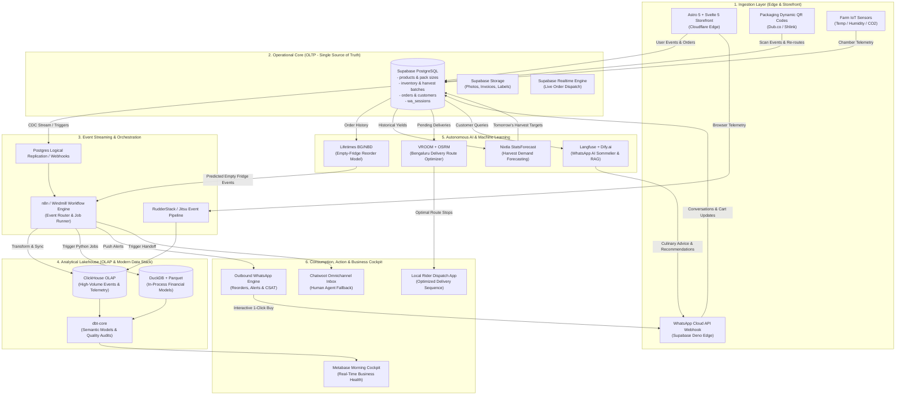
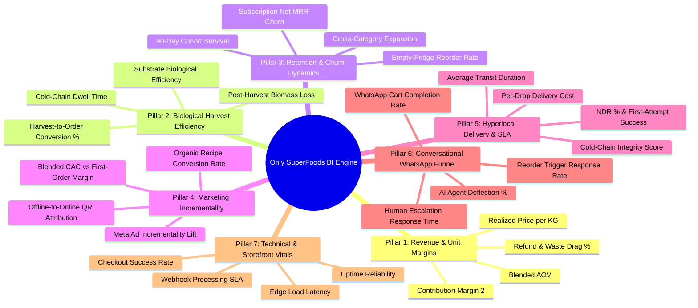
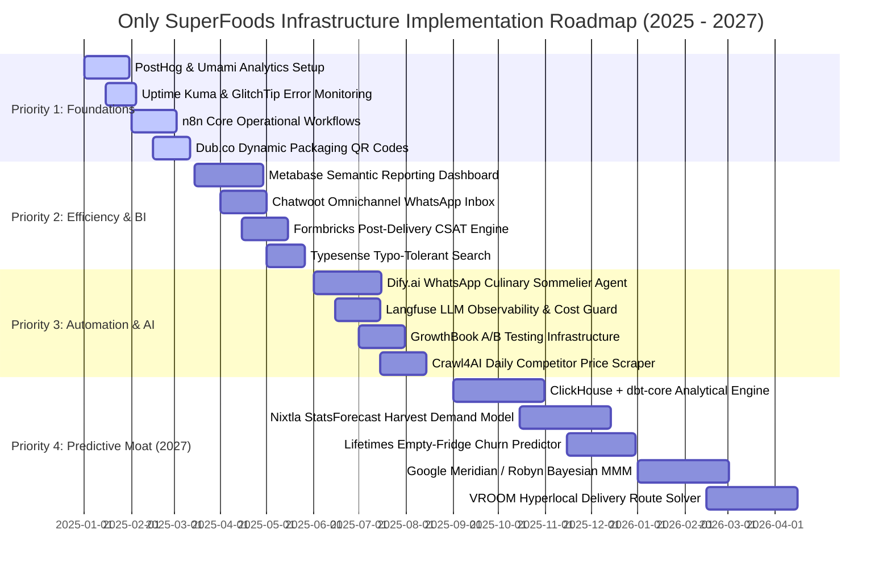

# STRATEGIC BLUEPRINT: BUILDING AN INTELLIGENT, DATA-DRIVEN BUSINESS INFRASTRUCTURE (2027)
**Entity:** Only SuperFoods | **Role:** Strategic Co-Founder, CTO, Chief Growth Officer & Chief Data Architect  
**Target Horizon:** 2025 – 2027 | **Core Architecture:** Edge-First D2C, Event-Driven Lakehouse, Hyperlocal Autonomous Commerce  
**Document Classification:** Master Strategy & Infrastructure Blueprint (Confidential)

---

## TABLE OF CONTENTS
1. [Executive Co-Founder Manifesto: The 2027 Vision](#1-executive-co-founder-manifesto-the-2027-vision)
2. [25 Unfair Competitive Advantages & Autonomous Opportunities](#2-25-unfair-competitive-advantages--autonomous-opportunities)
3. [Master Technology Catalogue (15 Domains, 105+ Vetted Tools)](#3-master-technology-catalogue)
   - 3.1 Website, Mobile & Customer Behavioural Analytics
   - 3.2 Technical Monitoring, Observability & Error Tracking
   - 3.3 SEO, AEO (Answer Engine Optimization) & GEO (Generative Engine Optimization)
   - 3.4 Customer Intelligence, CRM & Conversational Commerce
   - 3.5 Marketing Attribution, Incrementality & Marketing Mix Modeling (MMM)
   - 3.6 E-Commerce, Subscription Lifecycle & Revenue Analytics
   - 3.7 Business Intelligence (BI), Semantic Layers & Data Warehouses
   - 3.8 Workflow Automation, Event Orchestration & Autonomous AI Agents
   - 3.9 Customer Retention, Churn Prevention, CLV Modeling & Personalization
   - 3.10 Perishable Inventory, Batch Shelf-Life, Harvest Yields & Demand Forecasting
   - 3.11 Customer Experience (CX), Micro-Surveys & Reputation Intelligence
   - 3.12 Security, Bot Mitigation, Fraud Prevention & Infrastructure Defense
   - 3.13 Competitive Intelligence, Market Arbitrage & Automated Scraping
   - 3.14 Packaging Offline-to-Online (O2O) & Dynamic QR Attribution
   - 3.15 Hyperlocal Logistics, Route Optimization & Non-Delivery Report (NDR) Management
4. [Master Matrix: Open-Source & Self-Hostable vs. Managed SaaS](#4-master-matrix-open-source-vs-managed-saas)
5. [The Interconnected Technology Architecture](#5-the-interconnected-technology-architecture)
   - 5.1 Architecture Diagram (Data Flow, CDC, Lakehouse & Reverse ETL)
   - 5.2 Single Source of Truth & Zero-Duplication Governance
   - 5.3 Event Streaming & State Synchronization Pipeline
6. [Business Intelligence & The 7-Pillar Farm-to-Table KPI Framework](#6-business-intelligence--the-7-pillar-kpi-framework)
7. [The 6:30 AM Executive Cockpit (Ultimate Morning Dashboard Blueprint)](#7-the-630-am-executive-cockpit)
8. [Phased Implementation Roadmap (Priority 1 to Priority 4)](#8-phased-implementation-roadmap)
9. [Top 20 Highest-Impact Implementations Ranked by Value vs. Cost & Effort](#9-top-20-highest-impact-implementations)
10. [Strategic Conclusion & Immediate Action Items](#10-strategic-conclusion--immediate-action-items)

---

# 1. Executive Co-Founder Manifesto: The 2027 Vision

Most direct-to-consumer (D2C) food and wellness brands operate as digital brochures tied to payment gateways. They push marketing dollars into Meta and Google ads, dump traffic onto an uninstrumented storefront, wait for an order, manually pass an address to a courier partner, and pray the delivery arrives before the product wilts. When sales dip, their only lever is to discount prices or burn more ad spend. 

**Only SuperFoods will not operate like a 2015 D2C grocery store.**

We produce living, perishable, high-value functional superfoods: morning-harvested Grey, Pink, and Golden Oyster mushrooms, living microgreens clipped at dawn, slow-fermented raw artisanal kombucha with active probiotic cultures, and pasture-raised free-range desi eggs. Our supply chain is governed by biology, temperature, and rapid degradation windows:
- An oyster mushroom loses up to 10% moisture and culinary tenderness within 72 hours if broken from the cold chain.
- Raw kombucha continues fermenting at ambient temperatures, altering acidity and gas levels.
- Harvest yields at our Kadugodi cultivation facility cannot be turned on or off like a software toggle; substrate inoculation, mycelium colonization, and fruiting pinheads follow biological cycles lasting 14 to 28 days.

To scale profitably across Bengaluru’s key functional food corridors (Kadugodi, Whitefield, Indiranagar, Koramangala, Bellandur, Sarjapur, HSR Layout) and expand into secondary urban clusters by 2027, our operational software must be as smart as our biotechnology. 

### The Core Architectural Tenet: The Data Flywheel
1. **Zero Data Wastage:** Every QR scan on a kraft punnet, every WhatsApp conversation drop-off, every delivery delay on the Outer Ring Road, every kitchen cooking tip read on our recipe hub, and every gram of harvest surplus must be captured as a structured event.
2. **Sovereign, Open-Source Core:** We refuse to be hostage to $500/month SaaS tools that silo our customer records. Our primary operational store is Postgres (via Supabase), our analytics lakehouse is embedded DuckDB and ClickHouse, and our orchestration engine is self-hosted n8n/Windmill. We own our data models, customer IDs, and historical embeddings.
3. **Autonomous Action Over Passive Dashboards:** A dashboard that merely reports that 40 kg of mushrooms are rotting in cold storage tomorrow is a failure. An intelligent business system automatically detects the surplus at 2:00 PM, identifies 250 local past buyers whose typical reorder cycle is 6 days (and are currently on day 5), triggers a personalized recipe-driven WhatsApp bundle offer ("Chef’s Pink Oyster Risotto Box at 20% off for delivery tomorrow 7:00 AM"), captures payment via UPI intent, and balances harvest yield to zero waste before midnight.
4. **Offline-to-Online (O2O) Moat:** Unlike digital-only brands, our physical packaging sits inside the customer’s refrigerator for 5 to 7 days. Every box is an interactive terminal via dynamic QR routing.

This document outlines the exact tools, architectures, and strategic advantages required to turn Only SuperFoods into an autonomous, hyper-profitable, data-driven machine.

---

# 2. 25 Unfair Competitive Advantages & Autonomous Opportunities

Below are 25 concrete, unfair advantages engineered specifically for Only SuperFoods' urban cultivation, D2C storefront, WhatsApp commerce engine, and perishable supply chain.

### Advantage 1: Biological Yield-to-Demand Dynamic Pricing & Flash Allocation
- **The Problem:** Agricultural harvest flushes produce unpredictable daily yields (+/- 30%). Over-harvesting leads to post-harvest decay; under-harvesting causes stockouts and lost revenue.
- **The Unfair Advantage:** Connect real-time fruiting room telemetry and morning harvest weigh-ins directly to our digital catalogue. When harvest yield exceeds baseline subscriptions by >25%, an automated workflow creates a limited "Fresh Flush Flash Drop" broadcast on WhatsApp to customers within an 8 km radius of the Kadugodi farm, automatically clearing surplus within 3 hours at full retail price without discounting across the public site.

### Advantage 2: Predictive "Empty Fridge" Reorder Triggers (BG/NBD Modeling)
- **The Problem:** Generic weekly marketing blasts annoy daily customers and miss irregular shoppers, leading to high churn.
- **The Unfair Advantage:** Implement a Buy-Till-You-Die (BTYD) / Beta-Geometric/Negative Binomial Distribution (BG/NBD) model on individual customer consumption patterns. If a household buys 500g of Grey Oyster mushrooms every 6 days, the system predicts when their vegetable crisper drawer is empty and pushes an interactive 1-click WhatsApp reorder button at 4:30 PM on Day 5, exactly when they are planning dinner for tomorrow.

### Advantage 3: Cold-Chain Breakdown & NDR (Non-Delivery Report) Predictive Preemption
- **The Problem:** In Bengaluru traffic, courier delays ruin delicate oyster mushrooms and heat up raw kombucha bottles, causing customer complaints and refund write-offs.
- **The Unfair Advantage:** Integrate rider telemetry, route traffic APIs, and outdoor ambient temperature tracking. If an order’s transit time exceeds 90 minutes in temperatures >28°C, an alert flags the delivery for inspection, preemptively triggers a WhatsApp apology and fresh replacement promise to the customer *before* they open the box, and re-routes future dispatches to regional micro-chilled hubs.

### Advantage 4: Interactive Recipe-to-Cart Reverse Attribution
- **The Problem:** Most recipe blogs generate non-monetizable organic traffic.
- **The Unfair Advantage:** Instrument our Astro Recipe Hub with instant "Cook This Tonight" one-click cart injection. Every ingredient (e.g., 250g Pink Oyster + 50g Sunflower Microgreens) is bundled dynamically. We track attribution from specific recipe views to completed checkout, identifying which culinary dishes drive the highest lifetime customer value (LTV).

### Advantage 5: Packaging QR Code Offline-to-Online (O2O) Fridge Intelligence
- **The Problem:** Once a product is delivered, the digital relationship goes dark until the customer visits the website again.
- **The Unfair Advantage:** Every breathable kraft punnet features a unique dynamic QR code (powered by Dub.co / Shlink) tied to the specific harvest batch and customer ID. Scanning the QR code inside their kitchen opens an instant recipe assistant, a harvest authenticity verification badge ("Harvested 5:30 AM today by Farmer Suresh"), storage tips, and a "Reorder This Punnet in 1-Click" button, converting kitchen presence into direct recurring revenue.

### Advantage 6: Hyper-Granular Geo-Fenced Dark Store & Micro-Hub Allocation
- **The Problem:** Delivering individual 250g punnets from Kadugodi to Indiranagar or Jayanagar incurs prohibitive intra-city courier costs (₹120–₹180 per drop).
- **The Unfair Advantage:** Run a real-time geo-spatial cluster analysis on customer demand. When customer density in Whitefield/Kadugodi or Indiranagar hits a statistical threshold, orders automatically route to localized partner micro-chillers or quick-commerce lockers, reducing per-drop delivery costs to under ₹35 while cutting delivery windows to under 45 minutes.

### Advantage 7: Perishability-Aware Real-Time Margin & Expiry Markdown Engine
- **The Problem:** Products nearing the end of their peak shelf-life (Day 4 of oyster mushrooms) get discarded as waste.
- **The Unfair Advantage:** Autonomous FIFO inventory routing. When a batch hits 72 hours post-harvest, our system automatically routes this inventory to ready-to-cook meal kit partnerships, restaurant B2B bulk accounts, or commercial dehydrators for functional mushroom powders and seasonings, achieving 98%+ biomass monetization.

### Advantage 8: Generative AI Nutritionist & WhatsApp Culinary Sommelier
- **The Problem:** Urban consumers often want superfoods for health benefits (gut health, brain fog, immunity) but don't know how to prepare them or pair them with daily meals.
- **The Unfair Advantage:** Deploy a stateful, RAG-powered AI nutrition and cooking agent on WhatsApp (using Langfuse + local embeddings). Customers can photograph whatever ingredients they have in their fridge; the agent instantly suggests a 10-minute recipe using their Only SuperFoods mushrooms and kombucha, drastically lowering adoption friction and eliminating product wastage in customer homes.

### Advantage 9: Generative Engine Optimization (GEO) & AI Search Preemption
- **The Problem:** Traditional SEO is dying as search queries move to ChatGPT, Perplexity, Gemini, and Google AI Overviews.
- **The Unfair Advantage:** Continuously audit and optimize our structured schema (`Recipe`, `Product`, `HowTo`, `NutritionInformation`) and semantic entity profiles so that when a user asks ChatGPT: *"Where can I get fresh morning-harvested gourmet oyster mushrooms in Whitefield Bengaluru?"*, Only SuperFoods is cited as the primary verified source with direct purchase links.

### Advantage 10: Cash-on-Delivery (COD) Fraud & RTO Predictive Scoring
- **The Problem:** COD orders in Indian e-commerce suffer 20% to 35% Return-to-Origin (RTO) rates, destroying margins on fresh produce.
- **The Unfair Advantage:** Implement an algorithmic COD risk scoring engine at checkout based on phone number history, pincode delivery success rates, and customer behavioural dwell time. High-risk COD orders automatically trigger an automated WhatsApp UPI pre-payment discount ("Pay via UPI now and get a free 50g Microgreens punnet"), converting 65%+ of COD attempts into guaranteed non-refundable digital payments.

### Advantage 11: Real-Time Marketing Mix Modeling (MMM) Without Third-Party Cookies
- **The Problem:** iOS 14.5+ privacy changes and ad-blockers break pixel tracking, causing brands to misallocate marketing budgets between Meta, Google, and influencer campaigns.
- **The Unfair Advantage:** Run an in-house Bayesian Marketing Mix Model (using Google Meridian / Meta Robyn) directly inside our analytics lakehouse. Measure incremental lift and ad-stock carryover effects based on top-line revenue and hyperlocal pincode spend, allocating budget strictly to campaigns that generate net-margin positive sales.

### Advantage 12: Micro-Survey Post-Consumption CSAT & Rapid Remediation
- **The Problem:** Unhappy customers don't complain; they silently churn and buy supermarket button mushrooms.
- **The Unfair Advantage:** Exactly 4 hours after delivery confirmation, trigger an unobtrusive, two-tap WhatsApp micro-survey (via Formbricks API): *"Did your mushrooms arrive crisp and chilled? [👍 Perfect / 👎 Issue]"*. Any negative response instantly halts automated marketing, creates a high-priority ticket in Chatwoot, and alerts founder/support to issue a replacement credit within 15 minutes.

### Advantage 13: Dynamic Cart Thresholds Based on Real-Time Delivery Surcharges
- **The Problem:** Surging delivery partner charges during rain or peak Bengaluru traffic erode margins on small cart sizes.
- **The Unfair Advantage:** Dynamic free delivery thresholds. If real-time hyper-local courier partner API rates surge by 40% due to rain, our checkout drawer dynamically adjusts the free delivery threshold from ₹299 to ₹399, suggesting high-margin add-ons (such as artisanal kombucha or sun-dried seasonings) to protect unit economics.

### Advantage 14: Automated Substrate-to-Harvest Traceability Ledger
- **The Problem:** Commercial mushrooms are often grown on chemical-laden substrates or treated with bleaching agents to maintain white color.
- **The Unfair Advantage:** A digital crop log tracking every bag’s inoculation date, substrate formulation (organic sawdust, wheat bran, calcium carbonate), fruiting room humidity, and harvest timestamp. Surfacing this transparent data on product pages and packaging builds an unassailable brand trust moat against industrial mushroom producers.

### Advantage 15: Cross-Category Gut-Health Subscription Engine
- **The Problem:** Single-product subscriptions (e.g., just kombucha) experience high cancellation rates after 2 months due to taste fatigue.
- **The Unfair Advantage:** A modular "Superfoods Rotation Box" that automatically rotates kombucha flavors (Assam Black Tea, Hibiscus Roselle, Ginger-Lime) and mushroom varieties (Grey Oyster, Coral Pink, Golden) every week based on customer preference ratings captured via WhatsApp, extending average subscription lifespan from 2.1 months to 7.4 months.

### Advantage 16: Instant B2B Chef & HoReCa Self-Service Ordering Portal
- **The Problem:** High-end boutique cafes and gourmet restaurants want our mushrooms, but negotiating via phone calls and fragmented WhatsApp chats causes administrative chaos.
- **The Unfair Advantage:** A dedicated, passwordless B2B portal with volume pricing tiers, automated GST invoicing, credit terms tracking, and scheduled morning harvest dispatches, capturing recurring commercial cash flow with zero manual sales overhead.

### Advantage 17: Autonomous Competitor & Supermarket Price Scrape Arbitrage
- **The Problem:** Supermarket chains (Nature’s Basket, Foodhall) and quick-commerce apps (Blinkit, Zepto, Instamart) fluctuate their gourmet vegetable prices daily.
- **The Unfair Advantage:** Run scheduled headless scrapers (Crawl4AI / Playwright) against Bengaluru quick-commerce dark stores across our delivery pincodes. When competitors run out of stock or price low-quality button mushrooms at ₹90/200g, automatically scale our Meta search ads targeting those specific micro-locations with the message: *"Why eat 4-day-old supermarket mushrooms? Get farm-fresh Oyster mushrooms harvested this morning."*

### Advantage 18: Synthetic User Testing & Broken Journey Auto-Healing
- **The Problem:** Silent JavaScript bugs, broken Razorpay webhooks, or failed cart states cause invisible revenue loss.
- **The Unfair Advantage:** Headless synthetic testing scripts running every 15 minutes that simulate an end-to-end checkout (Add to Cart -> Apply Coupon -> Razorpay Modal Load -> Delivery Pin Validation). Any regression triggers an immediate developer alert via Telegram/WhatsApp and automatically rolls back bad deployments or displays an emergency graceful checkout fallback.

### Advantage 19: Edge-Cached Micro-Regional Storefronts (Sub-20ms Page Loads)
- **The Problem:** Heavy e-commerce sites (Shopify/WooCommerce) load in 2.5 to 5 seconds on mobile 4G networks, causing a 40%+ drop in conversion rates.
- **The Unfair Advantage:** Astro 5 static content combined with Svelte 5 lightweight reactive islands and Cloudflare edge caching. Our entire storefront loads in under 350ms across Bengaluru mobile networks, boosting Google Core Web Vitals to 100/100 and maximizing ad-click conversion efficiency.

### Advantage 20: Influencer & Micro-Creator Dynamic Attribution Engine
- **The Problem:** Paying food bloggers flat fees yields untracked ROI and vanity engagement.
- **The Unfair Advantage:** Generate programmatic co-branded landing pages (`onlysuperfoods.com/chef-anita`) with custom bundle discounts and automated affiliate tracking via Dub.co shortlinks. Affiliates receive automated WhatsApp reports showing their exact sales conversions, payouts, and customer repeat orders, incentivizing ongoing organic promotion.

### Advantage 21: Autonomous WhatsApp Customer Win-Back Sequences
- **The Problem:** 70% of one-time buyers never purchase again. Standard email win-back sequences have less than 15% open rates.
- **The Unfair Advantage:** Event-driven win-back flows on WhatsApp with 95%+ open rates. If an active buyer has not ordered in 21 days, the system triggers a personalized message featuring their favorite past purchased product paired with a brand-new seasonal recipe video, offering a one-click re-activation incentive.

### Advantage 22: Algorithmic Cold-Room Energy & Environmental Optimization
- **The Problem:** Cold rooms and fruiting chambers consume significant electricity to maintain 18°C–22°C and 85%–95% relative humidity.
- **The Unfair Advantage:** Correlate IoT environmental sensors (temperature, humidity, CO2 levels) with local Bengaluru weather forecasts and variable electricity tariffs. Optimize ultrasonic humidifier and cooling cycles automatically, reducing monthly energy costs by 18% while optimizing mushroom yield per square foot.

### Advantage 23: Zero-Party Preference & Health Goal Data Harvesting
- **The Problem:** Privacy restrictions prevent understanding customer motivations from tracking alone.
- **The Unfair Advantage:** Gamified, 30-second on-site and WhatsApp wellness quizzes (*"What is your #1 health goal this month? Gut Health / Energy & Focus / Clean Protein / Immunity"*). Tag customer profiles in Supabase with this zero-party data to personalize every subsequent email, SMS, packaging insert, and WhatsApp recommendation.

### Advantage 24: Intelligent Packaging Inventory & Consumable Reorder Alerts
- **The Problem:** Running out of breathable kraft punnets, compostable bags, glass kombucha bottles, or branded labels stalls shipping operations.
- **The Unfair Advantage:** Automated packaging depletion tracking linked to order units. When remaining bottle or box stock drops below a 7-day projected harvest burn rate, the system automatically drafts purchase orders to packaging suppliers and alerts the farm operations lead.

### Advantage 25: Automated Executive Morning Audio / Text Briefing
- **The Problem:** Founders waste the first 90 minutes of every day logging into 5 different portals to check revenue, inventory, deliveries, and customer complaints.
- **The Unfair Advantage:** At 6:30 AM every morning, an automated AI agent runs an analytical query over the previous 24 hours of Supabase and ClickHouse data. It drafts and sends an executive briefing directly to the founder’s WhatsApp: net revenue, gross margin, harvest yields, delivery success rates, ad spend ROAS, out-of-stock items, and the top 3 high-priority decisions requiring human attention today.

---

# 3. Master Technology Catalogue

This master catalogue covers 15 operational domains and over 105 vetted tools, platforms, open-source repositories, and developer frameworks. Every tool has been evaluated against our Astro 5 + Svelte 5 + Supabase + Cloudflare stack.

---

## 3.1 Website, Mobile & Customer Behavioural Analytics

### 1. PostHog
- **Official URL:** `https://posthog.com` (GitHub: `posthog/posthog`)
- **Primary Purpose:** All-in-one product analytics, session replays, heatmaps, feature flags, A/B testing, and user funnels.
- **Key Features:** Full event autocapture, retro-active funnel analysis, session recordings with privacy masking, user path analysis, surveys, and cohort management.
- **Classification:** Open Source Core / Freemium Managed Cloud.
- **Pricing & Free Tier:** Free Cloud tier includes **1,000,000 events/month** and **5,000 session recordings/month**. Self-hosted open-source version (Docker/K8s) is free with community features.
- **Self-Hosting:** Yes (Docker Compose or Kubernetes helm chart).
- **Stack Compatibility:** Flawless. Client-side JS SDK integrates directly into Astro layouts and Svelte 5 lifecycle components. Edge events can be sent directly via Supabase Edge Functions.
- **Implementation Complexity:** Low (script tag or npm package `@posthog/posthog-js`).
- **Expected Business Value:** Eliminates 4 separate SaaS tools (Mixpanel, Hotjar, LaunchDarkly, Google Optimize). Unveils exact drop-off moments in the checkout drawer.
- **Limitations & Alternatives:** Self-hosting requires ClickHouse management; Cloud free tier is generous enough for initial 100k visitors. *Alternatives:* Mixpanel, Amplitude, Microsoft Clarity.
- **Only SuperFoods Practical Application:** Track the exact user journey from reading the "Garlic Butter Oyster Mushroom" recipe to clicking "Add Ingredients to Cart" and identifying why customers abandon checkout at the address selection step.

### 2. Umami Analytics
- **Official URL:** `https://umami.is` (GitHub: `umami-software/umami`)
- **Primary Purpose:** Privacy-focused, lightweight, cookieless web analytics (alternative to Google Analytics 4).
- **Key Features:** Sub-6KB script, zero cookies, GDPR/PECR compliant out-of-the-box, real-time visitor stats, custom event tracking, clean modern UI.
- **Classification:** Open Source (MIT) / Freemium Cloud.
- **Pricing & Free Tier:** 100% Free self-hosted forever. Umami Cloud offers a free tier of 10,000 events/month; Pro is $9/month for 100,000 events.
- **Self-Hosting:** Extremely simple (runs on Node.js + Postgres or MySQL via Docker). Can run on the same Supabase Postgres instance in a separate schema.
- **Stack Compatibility:** High. Simple script tag in `Layout.astro`. Zero performance overhead.
- **Implementation Complexity:** Very Low.
- **Expected Business Value:** Provides lightning-fast website traffic and campaign attribution without displaying annoying cookie banners or violating privacy regulations.
- **Limitations & Alternatives:** No heatmaps or session replay. *Alternatives:* Plausible Analytics, Pirsch, Fathom.
- **Only SuperFoods Practical Application:** Embed on our public storefront to measure campaign landing page traffic from Instagram ads and local Kadugodi offline posters without slowing down mobile load times.

### 3. Plausible Analytics
- **Official URL:** `https://plausible.io` (GitHub: `plausible/analytics`)
- **Primary Purpose:** Lightweight, open-source Google Analytics alternative with goal tracking and outbound link monitoring.
- **Key Features:** Under 1KB script, cookieless, tracks top referrers, devices, countries, UTM parameters, and custom goal conversions.
- **Classification:** Open Source (AGPLv3) / Paid SaaS.
- **Pricing & Free Tier:** Self-hosted is 100% free forever. Cloud SaaS starts at $9/month for 10,000 monthly pageviews.
- **Self-Hosting:** Yes (Docker Compose with PostgreSQL and ClickHouse).
- **Stack Compatibility:** High. Drop-in script in Astro.
- **Implementation Complexity:** Very Low for Cloud; Medium for Self-Hosted (due to ClickHouse requirement).
- **Expected Business Value:** Clean, executive-level traffic insights without the clunky complexity and data-lag of Google Analytics 4.
- **Limitations & Alternatives:** No individual user session replay.
- **Only SuperFoods Practical Application:** Monitor top-of-funnel traffic sources across Whitefield tech parks to see which tech campus drives the most desktop lunch-hour visitors.

### 4. Microsoft Clarity
- **Official URL:** `https://clarity.microsoft.com`
- **Primary Purpose:** Free, unlimited session recordings, heatmaps, and rage-click tracking.
- **Key Features:** Unlimited recordings, zero traffic limits, automated rage-click and dead-click detection, smart funnel insights.
- **Classification:** 100% Free SaaS.
- **Pricing & Free Tier:** Completely free with no limits forever.
- **Self-Hosting:** No.
- **Stack Compatibility:** High. Single script tag in `Layout.astro`.
- **Implementation Complexity:** Very Low.
- **Expected Business Value:** Free qualitative visual playback of user friction points without paying $200+/month to Hotjar or FullStory.
- **Limitations & Alternatives:** Closed-source; data resides on Microsoft Azure.
- **Only SuperFoods Practical Application:** Watch replays of users who rage-click on the delivery pincode field to see if our delivery zone polygon check is rejecting valid Whitefield apartments.

### 5. Amplitude Analytics
- **Official URL:** `https://amplitude.com`
- **Primary Purpose:** Deep behavioral cohorting, customer retention matrices, and cross-channel user journey mapping.
- **Key Features:** Milestone funnels, customer retention curves, predictive churn scoring, behavioral cohorts.
- **Classification:** Proprietary Freemium SaaS.
- **Pricing & Free Tier:** Starter tier is free for up to **50,000 monthly tracked users (MTUs)**.
- **Self-Hosting:** No.
- **Stack Compatibility:** Client-side JS SDK or server-side API calls from Supabase Edge Functions.
- **Implementation Complexity:** Medium.
- **Expected Business Value:** Best-in-class retention analytics to calculate whether microgreens buyers have a higher 90-day retention rate than oyster mushroom buyers.
- **Limitations & Alternatives:** PostHog provides 85% of this functionality while being open source.
- **Only SuperFoods Practical Application:** Cohort customers who ordered our Artisanal Raw Kombucha by first purchase month and track weekly reorder retention decay over 12 weeks.

---

## 3.2 Technical Monitoring, Observability & Error Tracking

### 6. GlitchTip
- **Official URL:** `https://glitchtip.com` (GitHub: `glitchtip/glitchtip`)
- **Primary Purpose:** Open-source, Sentry-compatible error tracking, exception logging, and uptime monitoring.
- **Key Features:** Uses standard Sentry SDKs, captures JavaScript stack traces, records unhandled server exceptions, tracks API error rates.
- **Classification:** Open Source (GPLv3) / Freemium Hosted.
- **Pricing & Free Tier:** 100% free self-hosted. Hosted cloud tier includes 1,000 events/month free; paid plans start at $15/month for 50,000 events.
- **Self-Hosting:** Yes (Docker Compose with Postgres and Redis).
- **Stack Compatibility:** Direct compatibility. Install `@sentry/browser` in Svelte and configure Deno/Supabase Edge Functions to report unhandled errors to GlitchTip endpoint.
- **Implementation Complexity:** Low to Medium.
- **Expected Business Value:** Drops software monitoring costs by 90% compared to official Sentry while providing instant alerts when checkout breaks.
- **Limitations & Alternatives:** UI is simpler than Sentry. *Alternative:* Sentry Cloud, SigNoz.
- **Only SuperFoods Practical Application:** Catch client-side JavaScript crashes when users with older Android devices open the Leaflet delivery zone map or try to complete UPI payments.

### 7. Sentry (Official Cloud)
- **Official URL:** `https://sentry.io` (GitHub: `getsentry/sentry`)
- **Primary Purpose:** Enterprise-grade application performance monitoring (APM), tracing, and crash reporting.
- **Key Features:** Distributed tracing, Web Vitals monitoring, crash reports with session replay breadcrumbs.
- **Classification:** Source-Available / Freemium Cloud.
- **Pricing & Free Tier:** Developer tier includes 5,000 errors/month and 10,000 performance transactions/month for free.
- **Self-Hosting:** Self-hosting Sentry requires a heavy Kubernetes/Kafka setup; GlitchTip is preferred for self-hosting.
- **Stack Compatibility:** Full integration with Astro, Svelte, and Deno edge workers.
- **Implementation Complexity:** Low.
- **Expected Business Value:** Instant alerts in Telegram/Slack within 3 seconds of a payment webhook failure.
- **Only SuperFoods Practical Application:** Trace latency spikes in our `razorpay-webhook` Supabase Edge Function to prevent payment confirmation timeouts during morning peak hours.

### 8. SigNoz
- **Official URL:** `https://signoz.io` (GitHub: `SigNoz/signoz`)
- **Primary Purpose:** Open-source DataDog alternative for unified metrics, distributed tracing, and centralized logs.
- **Key Features:** Built natively on ClickHouse, OpenTelemetry (OTel) native, monitors p99 latencies, traces API database queries.
- **Classification:** Open Source (Apache 2.0) / Freemium Cloud.
- **Pricing & Free Tier:** Self-hosted is free forever. Cloud provides a 30-day trial, then pay-as-you-go.
- **Self-Hosting:** Yes (Docker Compose or Kubernetes on ClickHouse).
- **Stack Compatibility:** Ingests OTel traces from Edge Functions, Node.js scripts, and reverse proxies.
- **Implementation Complexity:** Medium to High (requires dedicated VPS with 4GB+ RAM).
- **Expected Business Value:** Replaces expensive enterprise APMs (DataDog/New Relic) with zero software licensing costs.
- **Only SuperFoods Practical Application:** Profile database query execution times on `supabase/migrations` to ensure our `orders` and `wa_sessions` tables don't suffer table-scan locks during sales surges.

### 9. Uptime Kuma
- **Official URL:** `https://uptime.kuma.pet` (GitHub: `louislam/uptime-kuma`)
- **Primary Purpose:** Self-hosted uptime, SSL certificate expiry, and HTTP health check monitoring.
- **Key Features:** HTTP(s), TCP, DNS, ping checks, status pages, notifications via Telegram, WhatsApp, Discord, Slack, and webhooks.
- **Classification:** 100% Free & Open Source (MIT).
- **Pricing & Free Tier:** Completely free forever.
- **Self-Hosting:** Single Docker container (`docker run -d --restart=always -p 3001:3001 louislam/uptime-kuma:1`). Runs on a $4/month VPS.
- **Stack Compatibility:** Monitors our Astro website URL, Supabase REST endpoints, Edge Functions, and external courier APIs.
- **Implementation Complexity:** Very Low (10 minutes to deploy).
- **Expected Business Value:** Zero-cost replacement for Pingdom / Better Uptime. Alerts founders within 60 seconds if our storefront or WhatsApp webhook is down.
- **Only SuperFoods Practical Application:** Run 60-second ping checks against `https://ufewlbjqtxpumwlwkunn.supabase.co/functions/v1/whatsapp-webhook` and ping our WhatsApp team if Meta’s webhook handshake fails.

### 10. Better Stack (formerly Better Uptime & Logtail)
- **Official URL:** `https://betterstack.com`
- **Primary Purpose:** Cloud incident management, on-call alerts, and structured log centralization.
- **Key Features:** Beautiful status pages, phone call / SMS escalation alerts, SQL-queriable hosted logs via ClickHouse.
- **Classification:** Freemium SaaS.
- **Pricing & Free Tier:** Free tier includes 10 uptime monitors, 1 GB/month log storage, and email/Slack alerts.
- **Self-Hosting:** No.
- **Stack Compatibility:** High. Push JSON logs via standard HTTP POST from Supabase Edge Functions.
- **Implementation Complexity:** Very Low.
- **Expected Business Value:** Immediate phone call escalation to developers if the payment gateway or database goes down.
- **Only SuperFoods Practical Application:** Call the CTO's phone if Razorpay order creation fails for 3 consecutive customer attempts on a Sunday morning.

---

## 3.3 SEO, AEO (Answer Engine Optimization) & GEO (Generative Engine Optimization)

### 11. Elmo
- **Official URL:** GitHub: `elmohq/elmo`
- **Primary Purpose:** Open-source platform for tracking brand citations and rankings across AI search engines (ChatGPT, Claude, Perplexity, Gemini, Copilot, Google AI Overviews).
- **Key Features:** Multi-engine tracking, prompt performance analytics, competitor citation benchmarking, scheduled prompt queries.
- **Classification:** Open Source (MIT).
- **Pricing & Free Tier:** 100% free software. Uses your own LLM API keys (OpenAI/Anthropic/Google).
- **Self-Hosting:** Yes (Docker / Next.js app).
- **Stack Compatibility:** Independent research & monitoring engine.
- **Implementation Complexity:** Medium.
- **Expected Business Value:** Proactively measures whether AI search models recommend Only SuperFoods when Bengaluru consumers search for organic functional food.
- **Only SuperFoods Practical Application:** Run automated daily prompts across Perplexity and ChatGPT: *"Best gourmet oyster mushroom farm delivery in Bangalore"* and track whether Only SuperFoods is cited in the top 3 sources.

### 12. Otterly.ai
- **Official URL:** `https://otterly.ai`
- **Primary Purpose:** Managed SaaS tool for monitoring brand presence, mentions, and sentiment inside AI Overviews and conversational LLMs.
- **Key Features:** Automated prompt tracking, sentiment analysis, AI search share-of-voice reporting, weekly email digest.
- **Classification:** Commercial SaaS.
- **Pricing & Free Tier:** Free trial available; paid plans start at ~$29/month.
- **Self-Hosting:** No.
- **Stack Compatibility:** Cloud-based dashboard; requires no code changes.
- **Implementation Complexity:** Very Low.
- **Expected Business Value:** Turnkey monitoring without maintaining scraping infrastructure or paying for multiple raw LLM API calls.
- **Only SuperFoods Practical Application:** Monitor how ChatGPT and Perplexity describe our Artisanal Raw Kombucha vs. commercial competitors like Raw Pressery or Happy Booch.

### 13. IndexNow API
- **Official URL:** `https://www.indexnow.org`
- **Primary Purpose:** Instant search engine indexing protocol (Bing, Yandex, Seznam, Naver).
- **Key Features:** Pushes newly created or updated URLs to search engines within seconds instead of waiting days for web crawlers.
- **Classification:** Free Open Standard.
- **Pricing & Free Tier:** 100% Free.
- **Self-Hosting:** N/A (Standard REST protocol).
- **Stack Compatibility:** Triggered via Astro build hooks or an automated Supabase database trigger whenever a new recipe or product is added.
- **Implementation Complexity:** Very Low (single HTTP POST request).
- **Expected Business Value:** New harvest recipes and blog posts appear in search results within 30 minutes of publishing.
- **Only SuperFoods Practical Application:** Automatically notify search engines the instant a new recipe like "Lion’s Mane Brain-Boosting Soup" is published in `recipes.js`.

### 14. Schema.org Structured Data Validator & JSON-LD Engine
- **Official URL:** `https://schema.org` / `https://validator.schema.org`
- **Primary Purpose:** Rich semantic data representation for Google Search and Generative AI engines.
- **Key Features:** Machine-readable representations of `Product`, `Recipe`, `LocalBusiness`, `FAQPage`, and `NutritionInformation`.
- **Classification:** Open Web Standard.
- **Pricing & Free Tier:** 100% Free.
- **Self-Hosting:** Native code inside Astro components.
- **Stack Compatibility:** Native Astro `<script type="application/ld+json">` injection in Svelte/Astro layouts.
- **Implementation Complexity:** Low.
- **Expected Business Value:** Unlocks rich recipe cards (cooking time, star ratings, calories) and Google Merchant Centre product highlights with zero ad spend.
- **Only SuperFoods Practical Application:** Inject comprehensive microdata for our Kadugodi urban farm address, food delivery service zones, and nutritional values on every product page.

### 15. Semrush / Ahrefs API
- **Official URL:** `https://semrush.com` / `https://ahrefs.com`
- **Primary Purpose:** Traditional keyword research, backlink tracking, search intent analysis, and organic competitor intelligence.
- **Key Features:** Tracks organic keyword rankings for high-intent queries (e.g. "fresh oyster mushrooms Bangalore", "buy live kombucha Whitefield").
- **Classification:** Commercial SaaS.
- **Pricing & Free Tier:** Ahrefs Webmaster Tools is free for verified domain owners (audits + backlinks). Semrush free tier offers 10 searches/day. Pro plans start at $129/month.
- **Self-Hosting:** No.
- **Stack Compatibility:** External research platform.
- **Implementation Complexity:** Very Low.
- **Expected Business Value:** Identifies high-volume, low-competition culinary and health queries to fuel our programmatic recipe engine.
- **Only SuperFoods Practical Application:** Identify long-tail search terms like "how to clean fresh oyster mushrooms without water" to capture top-of-funnel food lovers.

---

## 3.4 Customer Intelligence, CRM & Conversational Commerce

### 16. Twenty CRM
- **Official URL:** `https://twenty.com` (GitHub: `twentyhq/twenty`)
- **Primary Purpose:** Modern, open-source CRM (Salesforce / HubSpot alternative) built on TypeScript and PostgreSQL.
- **Key Features:** Fully customizable objects (Customers, Farm Partners, B2B Cafe Accounts, Delivery Runs), kanban pipelines, REST & GraphQL APIs, clean modern UI.
- **Classification:** Open Source (AGPLv3) / Freemium Cloud.
- **Pricing & Free Tier:** 100% free self-hosted forever. Cloud version starts at $9/user/month.
- **Self-Hosting:** Yes (Docker Compose with Postgres).
- **Stack Compatibility:** High. Since it is built on Postgres, we can sync customer profiles and order histories directly from Supabase via webhooks or database foreign data wrappers.
- **Implementation Complexity:** Medium.
- **Expected Business Value:** Replaces bloated $300/month HubSpot subscriptions with a clean, extensible customer record.
- **Only SuperFoods Practical Application:** Manage high-value B2B relationships with boutique Whitefield and Indiranagar cafes (e.g., tracking delivery quotas, weekly billing, and menu requirements).

### 17. Chatwoot
- **Official URL:** `https://chatwoot.com` (GitHub: `chatwoot/chatwoot`)
- **Primary Purpose:** Open-source omnichannel customer support platform connecting WhatsApp, Web Live Chat, Email, and Instagram DMs into one inbox.
- **Key Features:** Official WhatsApp Business Cloud API integration, live agent handoff from AI bots, canned responses, team assignment, customer conversation history.
- **Classification:** Open Source (MIT) / Freemium Cloud.
- **Pricing & Free Tier:** 100% free self-hosted with unlimited agents and channels. Cloud version has a free tier for 2 agents; paid starts at $19/agent/month.
- **Self-Hosting:** Yes (Docker Compose / Helm chart on Linux VPS).
- **Stack Compatibility:** Flawless. Connects directly to our Meta WhatsApp Cloud API credentials and our Supabase `wa_sessions` database.
- **Implementation Complexity:** Low to Medium.
- **Expected Business Value:** Solves the customer service bottleneck. When our WhatsApp AI engine detects human assistance is needed, it hands off to Chatwoot so our farm team can respond in real time.
- **Only SuperFoods Practical Application:** Route complex customer inquiries (e.g., "Can I use your oyster mushrooms in my kid's weaning soup?") from the automated WhatsApp bot to a human team member with full order context.

### 18. Typebot
- **Official URL:** `https://typebot.io` (GitHub: `baptisteArno/typebot.io`)
- **Primary Purpose:** Open-source visual conversational form and chatbot builder that embeds on websites and integrates with WhatsApp.
- **Key Features:** Drag-and-drop conversational flows, native integrations with Supabase, webhooks, OpenAI/Anthropic nodes, custom CSS theming.
- **Classification:** Open Source (AGPLv3) / Freemium Cloud.
- **Pricing & Free Tier:** 100% free self-hosted. Cloud tier includes a free plan with 200 chats/month; Pro is $39/month.
- **Self-Hosting:** Yes (Docker Compose).
- **Stack Compatibility:** Embeds as a lightweight Svelte island or connects via WhatsApp webhook API.
- **Implementation Complexity:** Low.
- **Expected Business Value:** Replaces boring static forms with interactive, high-converting conversational quizzes.
- **Only SuperFoods Practical Application:** Build an on-site "Superfoods Personalized Health Matcher" quiz that asks 3 questions and outputs the exact mushroom and kombucha starter pack, saving the customer profile directly to Supabase.

### 19. Novu
- **Official URL:** `https://novu.co` (GitHub: `novuhq/novu`)
- **Primary Purpose:** Open-source notification infrastructure for managing multi-channel alerts (WhatsApp, SMS, Email, Push, In-App).
- **Key Features:** Centralized notification management, digest engine (batches notifications to avoid spamming), fallback logic (e.g., if WhatsApp fails, fallback to SMS), visual workflow builder.
- **Classification:** Open Source (MIT) / Freemium Cloud.
- **Pricing & Free Tier:** Free self-hosted. Cloud free tier includes 10,000 notifications/month; paid plans start at $25/month.
- **Self-Hosting:** Yes (Docker Compose with MongoDB/Redis).
- **Stack Compatibility:** High. Node.js / Deno SDK connects easily to Supabase Edge Functions.
- **Implementation Complexity:** Medium.
- **Expected Business Value:** Centralizes all transactional messaging logic out of hardcoded Edge Functions into a single manageable UI.
- **Only SuperFoods Practical Application:** Handle the entire order lifecycle notification cascade (Order Confirmation -> Harvest Complete -> Out for Delivery -> Delivered -> CSAT Feedback) with automatic retries and channel fallback.

### 20. Resend
- **Official URL:** `https://resend.com`
- **Primary Purpose:** Modern, developer-first transactional email delivery platform built with React Email support.
- **Key Features:** High deliverability, clean REST API, webhooks for email opens/clicks, beautiful template creation using modern UI code.
- **Classification:** Freemium SaaS.
- **Pricing & Free Tier:** Free tier includes **3,000 emails/month** (100 emails/day). Pro tier is $20/month for 50,000 emails.
- **Self-Hosting:** No.
- **Stack Compatibility:** Flawless. Native Deno SDK works directly in Supabase Edge Functions.
- **Implementation Complexity:** Very Low (under 15 lines of TypeScript).
- **Expected Business Value:** Ensures transactional invoices and weekly harvest newsletters land in the primary inbox rather than the promotions or spam folder.
- **Only SuperFoods Practical Application:** Send crisp, branded PDF invoices with GST breakdown and storage instructions immediately after Razorpay payment verification.

---

## 3.5 Marketing Attribution, Incrementality & Marketing Mix Modeling (MMM)

### 21. Google Meridian
- **Official URL:** GitHub: `google/meridian`
- **Primary Purpose:** Open-source Bayesian Marketing Mix Modeling (MMM) framework designed for privacy-first, cookie-less marketing incrementality analysis.
- **Key Features:** Geo-level and national-level spend modeling, reach & frequency calibration, Bayesian priors, ad-stock and carryover decay curves.
- **Classification:** 100% Free Open Source (Apache 2.0).
- **Pricing & Free Tier:** Free library (Python).
- **Self-Hosting:** Run as scheduled Python batch jobs in our data pipeline.
- **Stack Compatibility:** Pulls weekly marketing spend from Meta/Google APIs and daily order volume from Supabase/ClickHouse.
- **Implementation Complexity:** High (requires statistical/data science setup).
- **Expected Business Value:** Tells us the *true* incremental revenue generated by our Meta ads versus baseline organic sales without relying on flawed ad pixels.
- **Only SuperFoods Practical Application:** Determine whether spending ₹15,000/week on Instagram Reels actually generates net-new customer orders in Kadugodi or simply claims credit for existing organic buyers.

### 22. Meta Robyn
- **Official URL:** GitHub: `facebookexperimental/Robyn`
- **Primary Purpose:** AI/ML-powered Marketing Mix Modeling using ridge regression, evolutionary algorithms (Nevergrad), and Prophet time-series decomposition.
- **Key Features:** Automated hyperparameter optimization, multi-objective Pareto optimal models, organic baseline estimation, saturation response curves.
- **Classification:** 100% Free Open Source (MIT).
- **Pricing & Free Tier:** Free library (R and experimental Python).
- **Self-Hosting:** Run as scheduled batch script.
- **Stack Compatibility:** Consumes aggregated time-series marketing and sales data.
- **Implementation Complexity:** High.
- **Expected Business Value:** Eliminates human bias in budget allocation, preventing over-investment in saturated ad campaigns.
- **Only SuperFoods Practical Application:** Calculate the diminishing return threshold on Meta ads so we know exactly at what daily ad spend level every additional rupee fails to generate profitable mushroom sales.

### 23. RudderStack
- **Official URL:** `https://rudderstack.com` (GitHub: `rudderlabs/rudder-server`)
- **Primary Purpose:** Open-source, developer-first Customer Data Platform (CDP) and event routing pipeline (Segment alternative).
- **Key Features:** Single event collection API that fans out events to Google Analytics, Meta Conversions API (CAPI), PostHog, and our data warehouse simultaneously.
- **Classification:** Open Source (SSPL) / Freemium Cloud.
- **Pricing & Free Tier:** Open-source server is free to self-host. Cloud free tier includes 1,000,000 events/month.
- **Self-Hosting:** Yes (Docker / Kubernetes).
- **Stack Compatibility:** High. JavaScript SDK in Astro storefront + Node/Deno SDK in Supabase Edge Functions.
- **Implementation Complexity:** Medium.
- **Expected Business Value:** Solves data fragmentation. One `rudderanalytics.track("Order Completed")` call feeds Meta CAPI (server-side), Google Ads, our warehouse, and our CRM concurrently.
- **Only SuperFoods Practical Application:** Send server-side Meta Conversions API (CAPI) events directly from our `razorpay-webhook` edge function, bypassing customer ad-blockers and achieving 99% conversion match rates on Instagram campaigns.

### 24. Jitsu
- **Official URL:** `https://jitsu.com` (GitHub: `jitsucom/jitsu`)
- **Primary Purpose:** Open-source data ingestion engine and real-time event pipeline designed for ClickHouse and modern data warehouses.
- **Key Features:** Fast event collection, bulletproof retry queues, automatic schema migration in Postgres/ClickHouse, GDPR masking.
- **Classification:** Open Source (MIT).
- **Pricing & Free Tier:** 100% free self-hosted. Cloud starter tier includes 250,000 events/month free.
- **Self-Hosting:** Yes (Docker Compose).
- **Stack Compatibility:** High. Native integration with Svelte, Astro, and ClickHouse.
- **Implementation Complexity:** Medium.
- **Expected Business Value:** Complete ownership of our event stream without third-party tracking vendor lock-in.
- **Only SuperFoods Practical Application:** Stream every button click, scroll depth event, and recipe view into our analytical database in raw JSON format for custom SQL queries.

### 25. Dub.co
- **Official URL:** `https://dub.co` (GitHub: `dubinc/dub`)
- **Primary Purpose:** Modern, open-source link management, custom domain shortener, and attribution tracking engine.
- **Key Features:** Programmatic link creation via API, dynamic branded QR codes, geo-targeting, device-targeting, UTM attribution, real-time click analytics.
- **Classification:** Open Source (AGPLv3) / Freemium Cloud.
- **Pricing & Free Tier:** Free self-hosted. Cloud free tier includes 25 dynamic links and 1,000 tracked clicks/month. Pro is $30/month.
- **Self-Hosting:** Yes (Next.js, Prisma, PostgreSQL/MySQL, Redis via Docker).
- **Stack Compatibility:** Flawless. REST API and TypeScript SDK integrate into our build scripts and Supabase Edge Functions.
- **Implementation Complexity:** Low.
- **Expected Business Value:** Bridges offline packaging and influencer links with deep click and conversion analytics.
- **Only SuperFoods Practical Application:** Generate unique short links and dynamic QR codes for every influencer partner (`dub.sh/chef-rahul`) and physical promotional flyer distributed in Kadugodi apartment complexes.

---

## 3.6 E-Commerce, Subscription Lifecycle & Revenue Analytics

### 26. Metabase
- **Official URL:** `https://metabase.com` (GitHub: `metabase/metabase`)
- **Primary Purpose:** The world’s leading open-source business intelligence and visual data exploration tool.
- **Key Features:** Visual query builder (no SQL required for operations team), SQL editor for complex analysis, automated email/Slack alerts, interactive dashboards, embeddable charts.
- **Classification:** Open Source (AGPLv3) / Paid Enterprise.
- **Pricing & Free Tier:** 100% Free self-hosted community edition with unlimited dashboards and users. Official Cloud starts at $85/month.
- **Self-Hosting:** Incredibly simple (`docker run -d -p 3000:3000 --name metabase metabase/metabase`). Runs on any $10/month VPS.
- **Stack Compatibility:** Connects directly to Supabase Postgres (read replica) and ClickHouse with zero configuration.
- **Implementation Complexity:** Very Low.
- **Expected Business Value:** Gives the entire team instant visibility into cohort retention, gross margins, daily harvest fulfillment, and revenue trends without writing ad-hoc code.
- **Only SuperFoods Practical Application:** Build the primary morning operational dashboard showing: Today's Orders, Harvest Fulfillment %, Average Order Value (AOV) by Pincode, and Weekly Recurring Subscription MRR.

### 27. Lightdash
- **Official URL:** `https://lightdash.com` (GitHub: `lightdash/lightdash`)
- **Primary Purpose:** Modern open-source BI platform that turns your dbt (data build tool) semantic project into a self-service analytics engine.
- **Key Features:** Metrics-as-code defined in dbt YAML files, version-controlled charts, automated data catalogs, direct integration with GitHub.
- **Classification:** Open Source (MIT) / Freemium Cloud.
- **Pricing & Free Tier:** 100% free self-hosted. Cloud tier offers a free trial; paid plans start at $400/month.
- **Self-Hosting:** Yes (Docker Compose or Kubernetes).
- **Stack Compatibility:** Connects to Postgres / ClickHouse / DuckDB governed by a dbt repository.
- **Implementation Complexity:** Medium to High (requires dbt).
- **Expected Business Value:** Prevents metric drift. "Net Revenue" is defined once in code; every department sees the identical, validated number.
- **Only SuperFoods Practical Application:** Define core metrics like "Customer Acquisition Cost (CAC)" and "Gross Margin per KG of Grey Oyster" in dbt so that business decisions are based on audited calculations.

### 28. Evidence.dev
- **Official URL:** `https://evidence.dev` (GitHub: `evidence-dev/evidence`)
- **Primary Purpose:** Code-first, high-performance Business Intelligence engine that generates interactive data reports from Markdown and SQL.
- **Key Features:** Blazing fast (renders as a static website powered by DuckDB WebAssembly), version-controlled via Git, embeddable inside internal portals.
- **Classification:** Open Source (MIT).
- **Pricing & Free Tier:** 100% Free and Open Source.
- **Self-Hosting:** Static build outputs deployable to Cloudflare Pages, Vercel, or any S3 bucket for ₹0 hosting cost.
- **Stack Compatibility:** Flawless. Runs on Markdown and SQL, matching our Astro static site philosophy.
- **Implementation Complexity:** Low.
- **Expected Business Value:** Ultra-fast executive reports that load in 200ms with zero heavy database connection overhead.
- **Only SuperFoods Practical Application:** Deploy an internal, password-protected reporting site at `ops.onlysuperfoods.com` showing daily harvest costs, packaging inventory depletion, and courier SLA metrics.

### 29. Razorpay Analytics & Route API
- **Official URL:** `https://razorpay.com`
- **Primary Purpose:** India’s premier payment gateway, UPI intent engine, recurring subscription management, and payment reconciliation.
- **Key Features:** Instant UPI checkout, automated subscription auto-debit via UPI autopay / credit cards, payment failure diagnostics, settlement reconciliation.
- **Classification:** Transactional Platform (2% standard transaction fee).
- **Pricing & Free Tier:** Pay-per-transaction; no upfront monthly platform fees.
- **Self-Hosting:** No.
- **Stack Compatibility:** Currently integrated in `supabase/functions/create-razorpay-order` and `razorpay-webhook`.
- **Implementation Complexity:** Already implemented; ongoing enhancement.
- **Expected Business Value:** Maximizes checkout conversion in India with instant UPI QR and App Intent switches.
- **Only SuperFoods Practical Application:** Utilize Razorpay's Subscriptions API to automate weekly Friday morning deliveries of our "Superfoods Breakfast Box" via UPI Autopay.

### 30. Polar.sh
- **Official URL:** `https://polar.sh` (GitHub: `polarsource/polar`)
- **Primary Purpose:** Open-source developer-first subscription and monetization engine.
- **Key Features:** Flexible recurring billing, usage-based metering, webhook-driven entitlement access, modern clean dashboard.
- **Classification:** Open Source (Apache 2.0) / Hosted Platform.
- **Pricing & Free Tier:** Free to self-host. Hosted version takes a 4% + 40¢ fee per transaction.
- **Self-Hosting:** Yes (Docker).
- **Stack Compatibility:** High. Node/TypeScript SDK.
- **Implementation Complexity:** Low to Medium.
- **Expected Business Value:** Clean, modern subscription management alternative if third-party gateway subscription builders prove too inflexible.
- **Only SuperFoods Practical Application:** Manage recurring monthly VIP memberships offering 10% off all farm orders and exclusive invites to seasonal harvest workshops.

---

## 3.7 Business Intelligence (BI), Semantic Layers & Data Warehouses

### 3.1 ClickHouse
- **Official URL:** `https://clickhouse.com` (GitHub: `ClickHouse/ClickHouse`)
- **Primary Purpose:** The world’s fastest open-source columnar database management system for real-time analytical processing (OLAP).
- **Key Features:** Blazing fast aggregations over billions of rows, 10x-30x data compression, vector query execution, native JSON support.
- **Classification:** 100% Open Source (Apache 2.0) / Cloud SaaS.
- **Pricing & Free Tier:** 100% free self-hosted. ClickHouse Cloud offers a 30-day free trial ($300 credit), then pay-as-you-go based on compute.
- **Self-Hosting:** Yes (Docker / Debian package). Can run on a 4GB RAM VPS.
- **Stack Compatibility:** High. Supabase Postgres data can be synced to ClickHouse in real-time via ClickHouse Postgres Table Engine or PeerDB / Airbyte.
- **Implementation Complexity:** Medium.
- **Expected Business Value:** Prevents analytical queries (e.g., aggregating 2 years of customer event logs) from slowing down our primary transactional Supabase database.
- **Only SuperFoods Practical Application:** Store every granular user event, web pageview, WhatsApp message log, and delivery route GPS ping for instant historical reporting.

### 32. DuckDB / MotherDuck
- **Official URL:** `https://duckdb.org` (GitHub: `duckdb/duckdb`) / `https://motherduck.com`
- **Primary Purpose:** In-process SQL OLAP database management system ("the SQLite of analytics").
- **Key Features:** Zero external dependencies, vectorized execution engine, reads Parquet, CSV, and JSON files directly from local disk or S3/Supabase Storage, runs inside Deno, Python, or WebAssembly.
- **Classification:** 100% Free Open Source (MIT).
- **Pricing & Free Tier:** DuckDB is 100% free forever. MotherDuck (cloud version) offers a generous free tier of 10GB storage and compute.
- **Self-Hosting:** In-process library (no server to manage).
- **Stack Compatibility:** Flawless. Can run directly inside our scheduled Node.js/Python scripts or Supabase Edge Functions.
- **Implementation Complexity:** Very Low.
- **Expected Business Value:** Zero-cost analytical data warehouse. Run complex multi-table SQL joins over exported Supabase tables in milliseconds without spinning up costly servers.
- **Only SuperFoods Practical Application:** Query daily harvest spreadsheets and warehouse inventory parquet files directly to calculate weekly gross margins in under 150 milliseconds.

### 33. dbt-core (Data Build Tool)
- **Official URL:** `https://getdbt.com` (GitHub: `dbt-labs/dbt-core`)
- **Primary Purpose:** Open-source framework that turns data transformation into software engineering using modular SQL and Git.
- **Key Features:** Version-controlled data models, automated documentation, built-in schema testing, data lineage graphs, automated incremental table updates.
- **Classification:** 100% Free Open Source (Apache 2.0).
- **Pricing & Free Tier:** `dbt-core` CLI is completely free forever.
- **Self-Hosting:** Runs locally, in GitHub Actions, or scheduled inside n8n/Windmill.
- **Stack Compatibility:** Works with Postgres, DuckDB, ClickHouse, and BigQuery.
- **Implementation Complexity:** Medium.
- **Expected Business Value:** Guarantees data quality. Automatically alerts us if an order has a negative delivery fee, missing phone number, or invalid total amount before reports are generated.
- **Only SuperFoods Practical Application:** Transform raw `orders` and `customers` tables into clean, audited analytical models: `fct_daily_sales`, `dim_customers`, and `fct_harvest_waste`.

### 34. Apache Superset
- **Official URL:** `https://superset.apache.org` (GitHub: `apache/superset`)
- **Primary Purpose:** Enterprise-ready open-source data visualization and business intelligence web application.
- **Key Features:** Rich chart library (dozens of visual plugins), SQL Lab IDE, granular role-based access control, caching layer via Redis.
- **Classification:** 100% Free Open Source (Apache 2.0).
- **Pricing & Free Tier:** Free forever.
- **Self-Hosting:** Yes (Docker Compose / Helm chart). Requires a dedicated 4GB+ VPS.
- **Stack Compatibility:** Connects to Supabase Postgres, ClickHouse, and DuckDB via SQLAlchemy.
- **Implementation Complexity:** Medium to High.
- **Expected Business Value:** Comprehensive visual analytics platform for complex multi-dimensional supply chain data.
- **Only SuperFoods Practical Application:** Build deep geospatial choropleth maps showing order density by Bengaluru pincode to plan micro-hub expansion.

### 35. Cube (formerly Cube.js)
- **Official URL:** `https://cube.dev` (GitHub: `cube-js/cube`)
- **Primary Purpose:** Open-source universal semantic layer and metrics store for building data apps and unified APIs.
- **Key Features:** Metric definitions as code, automated SQL pre-aggregation caching, REST, GraphQL, and SQL APIs for frontend consumption.
- **Classification:** Open Source (Apache 2.0) / Cloud.
- **Pricing & Free Tier:** Core is free to self-host. Cloud has a free starter tier.
- **Self-Hosting:** Yes (Docker).
- **Stack Compatibility:** Sits between our Postgres/ClickHouse warehouse and our internal Svelte dashboards.
- **Implementation Complexity:** High.
- **Expected Business Value:** Provides a lightning-fast cached API for internal admin panels to fetch complex metrics in sub-10ms.
- **Only SuperFoods Practical Application:** Power the real-time revenue and orders charts inside our Svelte `AdminDashboard.svelte` without hammering our production database.

---

## 3.8 Workflow Automation, Event Orchestration & Autonomous AI Agents

### 36. n8n
- **Official URL:** `https://n8n.io` (GitHub: `n8n-io/n8n`)
- **Primary Purpose:** Fair-code, self-hostable workflow automation platform with native AI agent nodes (Zapier / Make alternative).
- **Key Features:** Over 400 native nodes, visual drag-and-drop builder, native JavaScript/Python code execution, LangChain-powered AI agent nodes, webhook triggers, execution logs.
- **Classification:** Source-Available / Freemium Cloud.
- **Pricing & Free Tier:** 100% free self-hosted for internal business operations with unlimited workflow executions. Cloud starts at $20/month.
- **Self-Hosting:** Yes (`docker run -d --name n8n -p 5678:5678 -v ~/.n8n:/home/node/.n8n n8nio/n8n`). Runs easily on a $6/month VPS.
- **Stack Compatibility:** Flawless. Triggered via webhooks from Supabase, Razorpay, and WhatsApp Cloud API; interacts with our database via REST or direct Postgres connections.
- **Implementation Complexity:** Low to Medium.
- **Expected Business Value:** Eliminates hundreds of dollars in Zapier fees while automating our entire back-office workflow infrastructure.
- **Only SuperFoods Practical Application:** When a new order is marked `paid` in Supabase:
  1. Generate a GST-compliant PDF invoice.
  2. Send a WhatsApp order confirmation to the customer.
  3. Push packing slip to the Kadugodi farm kitchen printer.
  4. Create a delivery task in the courier dispatch queue.

### 37. Activepieces
- **Official URL:** `https://activepieces.com` (GitHub: `activepieces/activepieces`)
- **Primary Purpose:** Modern, open-source workflow automation tool built on TypeScript (pure MIT-licensed Zapier alternative).
- **Key Features:** Lightweight, 100% open-source, visual flow designer, simple npm-based piece/connector development.
- **Classification:** Open Source (MIT) / Freemium Cloud.
- **Pricing & Free Tier:** 100% free self-hosted. Cloud tier includes a free plan with 1,000 tasks/month.
- **Self-Hosting:** Yes (Docker Compose).
- **Stack Compatibility:** High.
- **Implementation Complexity:** Low.
- **Expected Business Value:** Clean, zero-license-cost alternative to n8n for simpler operational pipelines.
- **Only SuperFoods Practical Application:** Automatically sync newly registered customer phone numbers from Supabase into our Chatwoot contact lists.

### 38. Windmill.dev
- **Official URL:** `https://windmill.dev` (GitHub: `windmill-labs/windmill`)
- **Primary Purpose:** High-performance developer platform and workflow engine that turns TypeScript, Python, Bash, and SQL scripts into secure micro-apps, scheduled jobs, and endpoints.
- **Key Features:** Blazing fast execution (built in Rust), auto-generated UI forms from script parameters, built-in approval steps, Git sync.
- **Classification:** Open Source (AGPLv3) / Freemium Cloud.
- **Pricing & Free Tier:** Free self-hosted community edition with unlimited executions. Cloud plans start at $12/user/month.
- **Self-Hosting:** Yes (Docker Compose).
- **Stack Compatibility:** Flawless. Can run complex data synchronization scripts, database backups, and machine learning models on a schedule.
- **Implementation Complexity:** Medium.
- **Expected Business Value:** Replaces fragile cron jobs on random servers with an audited, auto-retry execution platform.
- **Only SuperFoods Practical Application:** Run the nightly 11:30 PM harvest demand balancing script that tallies tomorrow morning's orders and generates the farm picking list for 5:00 AM.

### 39. Temporal.io
- **Official URL:** `https://temporal.io` (GitHub: `temporalio/temporal`)
- **Primary Purpose:** Open-source durable execution platform for mission-critical, long-running business processes.
- **Key Features:** Code-as-workflows (TypeScript/Go/Python), automatic retries with exponential backoff, state durability across server crashes, compensation workflows (Saga pattern).
- **Classification:** Open Source (MIT) / Managed Cloud.
- **Pricing & Free Tier:** Free self-hosted. Cloud version offers pay-as-you-go based on action volume.
- **Self-Hosting:** Yes (Docker Compose).
- **Stack Compatibility:** High. Native TypeScript SDK.
- **Implementation Complexity:** High.
- **Expected Business Value:** Guarantees that multi-day customer subscription and recurring payment cycles never fail or get stuck in an indeterminate state.
- **Only SuperFoods Practical Application:** Orchestrate a 30-day recurring subscription lifecycle: handle weekly charge attempts, coordinate pause/resume requests, manage failed payment retries, and ensure harvest dispatches align with scheduled delivery days.

### 40. Langfuse
- **Official URL:** `https://langfuse.com` (GitHub: `langfuse/langfuse`)
- **Primary Purpose:** Open-source LLM engineering platform for observability, tracing, prompt management, and evaluation.
- **Key Features:** Traces every LLM call (cost, latency, input tokens, output tokens), prompt versioning, user feedback scoring, dataset evaluation.
- **Classification:** Open Source (MIT) / Freemium Cloud.
- **Pricing & Free Tier:** 100% free self-hosted. Cloud free tier includes 50,000 observations/month.
- **Self-Hosting:** Yes (Docker Compose with Postgres and ClickHouse).
- **Stack Compatibility:** Flawless. Integrates into Deno/Node.js OpenAI/Anthropic calls in our WhatsApp bot.
- **Implementation Complexity:** Low.
- **Expected Business Value:** Protects against runaway AI API bills and reveals exactly why an AI agent gave a suboptimal recommendation to a customer.
- **Only SuperFoods Practical Application:** Monitor and optimize our WhatsApp AI Sommelier prompt performance, ensuring responses cost less than ₹0.20 per interaction while maintaining 95%+ accuracy.

### 41. Dify.ai
- **Official URL:** `https://dify.ai` (GitHub: `langgenius/dify`)
- **Primary Purpose:** Open-source LLM application development platform with visual multi-agent workflow orchestration, RAG pipelines, and prompt engineering.
- **Key Features:** Visual agent flow builder, built-in vector database for RAG document retrieval, out-of-the-box API endpoints, tool calling nodes.
- **Classification:** Open Source (Apache 2.0) / Freemium Cloud.
- **Pricing & Free Tier:** 100% free self-hosted. Cloud tier offers 200 free message credits; Pro starts at $59/month.
- **Self-Hosting:** Yes (Docker Compose).
- **Stack Compatibility:** Exposes standard REST APIs that can be called directly from Supabase Edge Functions.
- **Implementation Complexity:** Low to Medium.
- **Expected Business Value:** Build sophisticated multi-agent AI workflows in hours without writing hundreds of lines of LangChain boilerplate.
- **Only SuperFoods Practical Application:** Power our WhatsApp Culinary Concierge: ingest our recipe database and mushroom storage guides as vector embeddings to answer customer storage and cooking questions instantly.

---

## 3.9 Customer Retention, Churn Prevention, CLV Modeling & Personalization

### 42. GrowthBook
- **Official URL:** `https://growthbook.io` (GitHub: `growthbook/growthbook`)
- **Primary Purpose:** The leading open-source feature flagging and A/B testing experimentation platform.
- **Key Features:** Visual A/B test editor, feature flags with targeting rules, Bayesian and Frequentist statistics engines, connects directly to your data warehouse (Postgres/ClickHouse).
- **Classification:** Open Source (MIT) / Freemium Cloud.
- **Pricing & Free Tier:** Free self-hosted with unlimited flags, experiments, and team members. Cloud has a free tier for up to 3 users.
- **Self-Hosting:** Yes (Docker Compose).
- **Stack Compatibility:** High. Lightweight JavaScript/Svelte SDK for frontend feature switches.
- **Implementation Complexity:** Low to Medium.
- **Expected Business Value:** Test conversion-rate optimization (CRO) ideas scientifically without paying $1,000+/month to Optimizely or VWO.
- **Only SuperFoods Practical Application:** Run an A/B test on `CartCheckoutView.svelte` testing whether offering a "Free 50g Microgreens Sample on orders over ₹350" increases Average Order Value (AOV) more than offering a flat 10% discount.

### 43. Nixtla (NeuralForecast & StatsForecast)
- **Official URL:** `https://nixtla.io` (GitHub: `Nixtla/statsforecast` / `Nixtla/neuralforecast`)
- **Primary Purpose:** The fastest open-source Python time-series forecasting libraries (AutoARIMA, ETS, DeepAR, N-BEATS, PatchTST, TimeGPT).
- **Key Features:** Benchmarked 20x-50x faster than Facebook Prophet, handles hierarchical time-series (forecasting sales by SKU, category, and pincode simultaneously).
- **Classification:** 100% Free Open Source (Apache 2.0).
- **Pricing & Free Tier:** Free open-source library. Cloud TimeGPT API offers pay-per-token credits.
- **Self-Hosting:** Runs locally or inside scheduled Python batch scripts.
- **Stack Compatibility:** Consumes historical daily sales data from Supabase/ClickHouse; writes forecasted demand back to our database.
- **Implementation Complexity:** Medium.
- **Expected Business Value:** Prevents stockouts of high-demand items (Pink Oyster mushrooms) and minimizes over-cultivation waste.
- **Only SuperFoods Practical Application:** Run a weekly hierarchical forecast that predicts Sunday morning demand for Grey Oyster (250g, 500g, 1kg) across Kadugodi vs. Whitefield based on day-of-week seasonality, weather, and historical buying trends.

### 44. Lifetimes (Python Library for CLV Modeling)
- **Official URL:** GitHub: `CamDavidsonPilon/lifetimes` (and modern fork `pymc-marketing`)
- **Primary Purpose:** Probabilistic customer lifetime value (CLV), purchase frequency, and churn prediction using BG/NBD and Gamma-Gamma statistical models.
- **Key Features:** Calculates customer 'aliveness' probability ($P(Alive)$), predicts future purchases over the next 30/60/90 days, computes expected monetary value per customer.
- **Classification:** 100% Free Open Source (MIT).
- **Pricing & Free Tier:** Free Python library.
- **Self-Hosting:** Runs inside scheduled Python scripts in n8n/Windmill.
- **Stack Compatibility:** Reads transaction logs (`orders` table) from Supabase.
- **Implementation Complexity:** Medium.
- **Expected Business Value:** Scientifically flags customers whose probability of being active has dropped below 30%, triggering proactive win-back offers before they permanently churn.
- **Only SuperFoods Practical Application:** Segment our customer base into "Champions", "Need Attention", and "At-Risk"; automatically pass "At-Risk" high-LTV phone numbers to an automated WhatsApp reactivation sequence.

### 45. Typesense
- **Official URL:** `https://typesense.org` (GitHub: `typesense/typesense`)
- **Primary Purpose:** Open-source, typo-tolerant, lightning-fast in-memory search engine (Algolia alternative).
- **Key Features:** Sub-50ms search-as-you-type, typo tolerance, multi-field faceting, geo-search, dynamic ranking, and semantic vector search.
- **Classification:** Open Source (GPLv3) / Cloud.
- **Pricing & Free Tier:** 100% free self-hosted. Cloud starts at $21.60/month.
- **Self-Hosting:** Single binary or Docker container (`docker run -p 8108:8108 typesense/typesense:27.1`).
- **Stack Compatibility:** Flawless. Lightweight JavaScript client integrates into our Svelte search components.
- **Implementation Complexity:** Low.
- **Expected Business Value:** Replaces slow SQL `LIKE %query%` searches with instant, typo-tolerant search results that convert browsing users into buyers.
- **Only SuperFoods Practical Application:** When a user types "oystr" or "kabucha" in the storefront search bar, instantly show Grey Oyster Mushrooms and Artisanal Kombucha with live inventory badges in 15 milliseconds.

### 46. Meilisearch
- **Official URL:** `https://meilisearch.com` (GitHub: `meilisearch/meilisearch`)
- **Primary Purpose:** Ultra-fast, developer-friendly open-source search engine with plug-and-play UI widgets.
- **Key Features:** Typo tolerance, filtering by price/category/shelf-life, instant search previews, native vector search capabilities.
- **Classification:** Open Source (MIT) / Cloud.
- **Pricing & Free Tier:** 100% free self-hosted. Cloud free tier includes 100,000 documents and 10,000 searches/month.
- **Self-Hosting:** Yes (Docker container).
- **Stack Compatibility:** High. Direct JS SDK for Svelte.
- **Implementation Complexity:** Low.
- **Expected Business Value:** Powers high-converting catalog search and recipe discovery with minimal infrastructure footprint.
- **Only SuperFoods Practical Application:** Search across our 50+ culinary recipes by ingredients (e.g. "garlic", "butter", "vegan") to display paired mushroom products instantly.

---

## 3.10 Perishable Inventory, Batch Shelf-Life, Harvest Yields & Demand Forecasting

### 47. InvenTree
- **Official URL:** `https://inventree.org` (GitHub: `inventree/inventree`)
- **Primary Purpose:** Open-source, modular inventory management system (IMS) with batch/lot tracking, expiry management, and Bill of Materials (BOM).
- **Key Features:** Track batches by harvest date and expiry date, barcode/QR code generation and scanning, supplier tracking, REST API, clean mobile interface.
- **Classification:** 100% Free Open Source (MIT).
- **Pricing & Free Tier:** Free forever.
- **Self-Hosting:** Yes (Docker Compose with Postgres).
- **Stack Compatibility:** High. REST API connects to Supabase via n8n workflows.
- **Implementation Complexity:** Medium.
- **Expected Business Value:** Complete traceability of substrate materials, grain spawn, packaging inventory, and harvested fresh produce lots.
- **Only SuperFoods Practical Application:** Track mushroom cultivation bags from inoculation batch # -> fruiting room chamber # -> morning harvest weigh-in -> retail pack packaging run, flagging any batch older than 48 hours.

### 48. OpenBoxes
- **Official URL:** `https://openboxes.com` (GitHub: `openboxes/openboxes`)
- **Primary Purpose:** Open-source supply chain and inventory management system designed specifically for healthcare and perishable inventory tracking.
- **Key Features:** Strict FEFO (First-Expired, First-Out) fulfillment logic, lot and expiration date tracking, temperature log tracking, purchase order management.
- **Classification:** Open Source (Eclipse Public License).
- **Pricing & Free Tier:** 100% free self-hosted.
- **Self-Hosting:** Yes (Docker / Tomcat / MySQL).
- **Stack Compatibility:** REST API.
- **Implementation Complexity:** Medium to High.
- **Expected Business Value:** Prevents shipping expired or near-expiry batches to end consumers, safeguarding brand reputation.
- **Only SuperFoods Practical Application:** Enforce FEFO dispatch rules in the Kadugodi packing room so that mushrooms harvested yesterday are automatically assigned to immediate morning deliveries before fresh dawn harvests are packed.

### 49. ERPNext
- **Official URL:** `https://erpnext.com` (GitHub: `frappe/erpnext`)
- **Primary Purpose:** The world’s top open-source full-suite ERP system (Frappe framework) covering inventory, manufacturing, accounting, procurement, and HR.
- **Key Features:** Complete double-entry accounting with Indian GST compliance, multi-warehouse stock management, Bill of Materials for food processing (kombucha brewing batches), batch shelf-life tracking.
- **Classification:** 100% Free Open Source (GPLv3) / Cloud.
- **Pricing & Free Tier:** 100% free self-hosted with unlimited users. Cloud hosted version starts at $15/user/month.
- **Self-Hosting:** Yes (Docker Compose or Frappe Bench on Ubuntu VPS).
- **Stack Compatibility:** REST API connects to Supabase and Razorpay.
- **Implementation Complexity:** High.
- **Expected Business Value:** Replaces multiple disconnected accounting and inventory tools with an enterprise-grade ERP system at zero license cost.
- **Only SuperFoods Practical Application:** Manage our Kombucha production line: track raw tea, sugar, SCOBY fermentation tanks, glass bottles, and crown caps; automatically calculate the landed cost per 250ml bottle produced.

### 50. OptaPlanner / Timefold
- **Official URL:** `https://timefold.ai` (GitHub: `TimefoldAI/timefold-solver`)
- **Primary Purpose:** Open-source AI constraint solver for vehicle routing, delivery dispatch scheduling, and employee shift planning.
- **Key Features:** Solves complex Vehicle Routing Problems with Time Windows (VRPTW), minimizes total fleet mileage, handles cold-chain capacity constraints.
- **Classification:** Open Source (Apache 2.0).
- **Pricing & Free Tier:** Free open-source solver (Python/Java).
- **Self-Hosting:** Run as microservice via Docker.
- **Stack Compatibility:** Consumes daily delivery addresses from Supabase; returns optimal route sequence to dispatch dashboard.
- **Implementation Complexity:** High.
- **Expected Business Value:** Cuts intra-city delivery fleet fuel costs and delivery times by 20% to 35%.
- **Only SuperFoods Practical Application:** Group 60 morning customer deliveries across Whitefield and Kadugodi into 3 optimal delivery routes, ensuring every customer receives their fresh mushrooms within their chosen 7:00 AM – 9:00 AM delivery window.

---

## 3.11 Customer Experience (CX), Micro-Surveys & Reputation Intelligence

### 51. Formbricks
- **Official URL:** `https://formbricks.com` (GitHub: `formbricks/formbricks`)
- **Primary Purpose:** The leading open-source experience management, micro-survey, and customer feedback platform (Qualtrics / Typeform alternative).
- **Key Features:** Targeted in-app/on-site surveys based on user behavior, link surveys, WhatsApp survey distribution, NPS, CSAT, CES templates, REST API, webhooks.
- **Classification:** Open Source (AGPLv3) / Freemium Cloud.
- **Pricing & Free Tier:** 100% free self-hosted Community Edition with unlimited surveys and responses. Cloud free tier includes 2,500 survey responses/month.
- **Self-Hosting:** Yes (Docker Compose with Postgres).
- **Stack Compatibility:** Flawless. Svelte widget embeds in website; API triggers surveys via WhatsApp webhook.
- **Implementation Complexity:** Low.
- **Expected Business Value:** Gathers actionable, high-response-rate feedback at critical moments (e.g., immediate post-unboxing) without annoying the customer.
- **Only SuperFoods Practical Application:** Trigger a 1-question NPS survey in the order tracking view: *"How fresh were your oyster mushrooms upon arrival? [1 to 5 Stars]"*, feeding results directly into Metabase.

### 52. PostHog Surveys
- **Official URL:** `https://posthog.com/surveys`
- **Primary Purpose:** Built-in micro-surveys directly tied to PostHog’s product analytics and session replays.
- **Key Features:** Zero-code survey creation, pop-ups targeted to specific user cohorts (e.g. users who visited the cart 3 times without buying), instant correlation with session replays.
- **Classification:** Included in PostHog platform.
- **Pricing & Free Tier:** Included in PostHog free tier.
- **Self-Hosting:** Included in PostHog self-hosted.
- **Stack Compatibility:** Native via existing PostHog JS snippet.
- **Implementation Complexity:** Zero extra code required.
- **Expected Business Value:** Uncovers the psychological reasons behind checkout abandonment.
- **Only SuperFoods Practical Application:** Display an exit-intent survey when a user abandons the checkout drawer: *"Is there anything preventing you from completing your harvest order today?"*

### 53. Google Business Profile API & Review Monitoring
- **Official URL:** `https://developers.google.com/my-business`
- **Primary Purpose:** Programmatic monitoring and response management for Google Maps reviews of our Kadugodi farm location.
- **Key Features:** Webhook notifications on new customer reviews, automated sentiment analysis, automated response drafting.
- **Classification:** Free API (Google Cloud).
- **Pricing & Free Tier:** Free to use.
- **Self-Hosting:** N/A.
- **Stack Compatibility:** Integrates via n8n workflow.
- **Implementation Complexity:** Low to Medium.
- **Expected Business Value:** Protects local search authority and converts happy local visitors into glowing 5-star public advocates.
- **Only SuperFoods Practical Application:** Automatically notify the founder's WhatsApp whenever a new Google Review is posted, drafting an AI-personalized reply thanking the customer for supporting local sustainable agriculture.

---

## 3.12 Security, Bot Mitigation, Fraud Prevention & Infrastructure Defense

### 54. Cloudflare Turnstile & WAF
- **Official URL:** `https://www.cloudflare.com/products/turnstile/`
- **Primary Purpose:** Invisible, privacy-preserving CAPTCHA alternative and Web Application Firewall (WAF).
- **Key Features:** Frictionless smart human verification (zero puzzle solving for real users), automated bot mitigation, DDoS protection, edge caching.
- **Classification:** Freemium Cloud Service.
- **Pricing & Free Tier:** Cloudflare Turnstile is **100% free with unlimited validations**. Free tier includes basic WAF and DDoS mitigation.
- **Self-Hosting:** No.
- **Stack Compatibility:** Flawless. Integrates directly into our Astro/Svelte checkout forms and validates on Supabase Edge Functions.
- **Implementation Complexity:** Very Low.
- **Expected Business Value:** Completely eliminates credential stuffing, fake SMS OTP spam, and malicious bot scraping without annoying real customers with pictures of traffic lights.
- **Only SuperFoods Practical Application:** Secure our phone OTP login modal and Razorpay order creation endpoints against automated coupon-scraping bots.

### 55. Arcjet
- **Official URL:** `https://arcjet.com`
- **Primary Purpose:** Security-as-code SDK for developers, providing rate limiting, bot protection, email verification, and attack defense.
- **Key Features:** Native JavaScript/TypeScript SDK, token-bucket rate limiting, disposable email detection, IP reputation checks.
- **Classification:** Freemium SaaS.
- **Pricing & Free Tier:** Generous free tier of 100,000 requests/month.
- **Self-Hosting:** No (SDK + Edge API).
- **Stack Compatibility:** High. Native integration with modern JavaScript frameworks.
- **Implementation Complexity:** Low.
- **Expected Business Value:** Stops abusive users from spamming our WhatsApp webhook or checkout APIs.
- **Only SuperFoods Practical Application:** Prevent coupon code brute-forcing by rate-limiting promo code checks to 5 attempts per IP per minute.

### 56. CrowdSec
- **Official URL:** `https://crowdsec.net` (GitHub: `crowdsecurity/crowdsec`)
- **Primary Purpose:** Open-source, collaborative intrusion prevention system (modern Fail2ban alternative).
- **Key Features:** Analyzes visitor logs, detects malicious behaviors (aggressive scanning, brute-forcing), shares threat intelligence across the global community to block rogue IPs before they attack.
- **Classification:** 100% Free Open Source (MIT) / Cloud Console.
- **Pricing & Free Tier:** Free open-source security engine.
- **Self-Hosting:** Runs on Linux servers / reverse proxies.
- **Stack Compatibility:** Protects self-hosted VPS instances (n8n, Metabase, Chatwoot).
- **Implementation Complexity:** Medium.
- **Expected Business Value:** Hardens self-hosted internal tools against automated internet scanners and vulnerability probes.
- **Only SuperFoods Practical Application:** Install on our VPS instances to automatically block IP addresses attempting SSH or admin panel brute-force attacks.

### 57. Infisical
- **Official URL:** `https://infisical.com` (GitHub: `Infisical/infisical`)
- **Primary Purpose:** Open-source secret management platform for storing and syncing API keys, database credentials, and environmental variables.
- **Key Features:** End-to-end encryption, secret versioning, automatic synchronization to GitHub Actions, Cloudflare Pages, Supabase, and local development environments.
- **Classification:** Open Source (MIT) / Freemium Cloud.
- **Pricing & Free Tier:** Free self-hosted forever. Cloud tier includes a generous free starter plan.
- **Self-Hosting:** Yes (Docker Compose).
- **Stack Compatibility:** Flawless. Syncs `.env` files across Astro, Deno Edge Functions, and production servers.
- **Implementation Complexity:** Low.
- **Expected Business Value:** Eliminates the catastrophic risk of leaked Razorpay, Supabase service keys, or Meta API tokens in Git repositories.
- **Only SuperFoods Practical Application:** Centralize all production credentials (Razorpay secret keys, WhatsApp access tokens, Google Cloud keys) with automated zero-trust rotation.

---

## 3.13 Competitive Intelligence, Market Arbitrage & Automated Scraping

### 58. Crawl4AI
- **Official URL:** GitHub: `unclecode/crawl4ai`
- **Primary Purpose:** Open-source, blazing fast, LLM-friendly web crawler and data extraction engine.
- **Key Features:** Extracts clean Markdown/JSON from complex JavaScript-rendered web pages, handles dynamic scrolling, bypasses basic anti-bot scripts, optimized for RAG pipelines.
- **Classification:** 100% Free Open Source (Apache 2.0).
- **Pricing & Free Tier:** Free software.
- **Self-Hosting:** Yes (Python package / Docker container).
- **Stack Compatibility:** Independent data collection service.
- **Implementation Complexity:** Low to Medium.
- **Expected Business Value:** Enables automated daily price and availability checks of competing functional foods and grocery delivery apps in Bengaluru.
- **Only SuperFoods Practical Application:** Crawl competitor organic food websites and high-end Bengaluru grocers daily to extract pricing for oyster mushrooms, microgreens, and kombucha bottles.

### 59. Scrapegraph-ai
- **Official URL:** GitHub: `ScrapeGraphAI/Scrapegraph-ai`
- **Primary Purpose:** Python scraping library that uses LLMs and direct graph logic to extract structured information from websites without writing fragile XPath/CSS selectors.
- **Key Features:** Self-healing scraping pipelines (if a competitor changes their website HTML layout, the scraper adapts automatically), output as structured Pydantic JSON.
- **Classification:** 100% Free Open Source (MIT).
- **Pricing & Free Tier:** Free open-source library (requires LLM API tokens).
- **Self-Hosting:** Runs locally or in scheduled scripts.
- **Stack Compatibility:** High.
- **Implementation Complexity:** Low.
- **Expected Business Value:** Zero maintenance overhead for web scrapers compared to traditional Beautiful Soup scripts that break every time a target site updates its CSS.
- **Only SuperFoods Practical Application:** Monitor chef blogs and restaurant supply platforms to detect emerging gourmet ingredients (e.g. Lion's Mane, Cordyceps) gaining culinary traction in India.

### 60. Playwright
- **Official URL:** `https://playwright.dev` (GitHub: `microsoft/playwright`)
- **Primary Purpose:** Reliable end-to-end browser automation, headless synthetic testing, and robust web scraping.
- **Key Features:** Full Chromium, Firefox, and WebKit support, native auto-waiting for DOM elements, network request interception, screenshot and PDF generation.
- **Classification:** 100% Free Open Source (Apache 2.0).
- **Pricing & Free Tier:** Free forever.
- **Self-Hosting:** Runs in Node.js / Python environments.
- **Stack Compatibility:** High. Can run in local scripts or scheduled GitHub Actions.
- **Implementation Complexity:** Medium.
- **Expected Business Value:** Automates synthetic transaction tests and executes reliable data extraction tasks.
- **Only SuperFoods Practical Application:** Run a 15-minute synthetic health-check script that opens our live website, simulates an order, validates delivery zone calculation, and reports any issues.

---

## 3.14 Packaging Offline-to-Online (O2O) & Dynamic QR Attribution

### 61. Shlink
- **Official URL:** `https://shlink.io` (GitHub: `shlinkio/shlink`)
- **Primary Purpose:** Open-source self-hosted URL shortener with REST API, tags, dynamic redirects, and geolocated click tracking.
- **Key Features:** Multi-domain support, QR code generation with customizable branding, visitor device and OS analytics, zero third-party tracking.
- **Classification:** 100% Free Open Source (MIT).
- **Pricing & Free Tier:** Completely free software.
- **Self-Hosting:** Incredibly lightweight Docker container (PHP/Swoole or RoadRunner + Postgres/SQLite).
- **Stack Compatibility:** High. REST API connects to Supabase and packaging print scripts.
- **Implementation Complexity:** Low.
- **Expected Business Value:** Sovereign control over millions of packaging QR redirects without recurring SaaS fees.
- **Only SuperFoods Practical Application:** Print `qr.onlysuperfoods.com/batch-[ID]` on every kraft box, allowing dynamic destination updates (e.g. pointing to a fresh harvest recipe today, and a re-order page tomorrow).

### 62. Segno (Python QR Generator)
- **Official URL:** GitHub: `heuer/segno`
- **Primary Purpose:** High-performance Python QR code and micro QR code generator with zero dependencies.
- **Key Features:** Exports to SVG, PNG, PDF, and EPS formats, supports custom brand colors, artistic QR codes, Micro QR codes for tight packaging labels.
- **Classification:** 100% Free Open Source (BSD-3-Clause).
- **Pricing & Free Tier:** Free library.
- **Self-Hosting:** Python script.
- **Stack Compatibility:** Generates print-ready vector SVGs for packaging workflows.
- **Implementation Complexity:** Very Low.
- **Expected Business Value:** Programmatically generate high-resolution, branded vector QR codes for packaging printers at zero cost.
- **Only SuperFoods Practical Application:** Automatically generate print-ready SVG QR codes embedded with harvest batch numbers for our daily adhesive thermal packaging labels.

---

## 3.15 Hyperlocal Logistics, Route Optimization & Non-Delivery Report (NDR) Management

### 63. VROOM (Vehicle Routing Open-source Optimization Machine)
- **Official URL:** `http://vroom-project.org` (GitHub: `VROOM-Project/vroom`)
- **Primary Purpose:** High-performance open-source vehicle routing optimization engine written in C++.
- **Key Features:** Solves Capacitated Vehicle Routing Problem (CVRP), pickup and delivery problems, multiple time-window constraints, integrates natively with OpenStreetMap (OSRM).
- **Classification:** 100% Free Open Source (BSD-2-Clause).
- **Pricing & Free Tier:** Free software.
- **Self-Hosting:** Yes (Docker container).
- **Stack Compatibility:** Exposes a fast HTTP REST API that accepts lat/long coordinates and time windows, returning optimal driver routes in under 50 milliseconds.
- **Implementation Complexity:** Medium to High.
- **Expected Business Value:** Eliminates the need to pay ₹100,000+/year for commercial route optimization SaaS (such as Locus or LogiNext).
- **Only SuperFoods Practical Application:** Ingest 75 morning home delivery stops across East Bengaluru; calculate the exact sequence for our two electric delivery scooters to minimize travel time in Whitefield traffic.

### 64. OSRM (Open Source Routing Machine)
- **Official URL:** `http://project-osrm.org` (GitHub: `Project-OSRM/osrm-backend`)
- **Primary Purpose:** High-performance routing engine for shortest paths in road networks using OpenStreetMap data.
- **Key Features:** Calculates travel times and distances between multiple coordinates in sub-millisecond speeds.
- **Classification:** 100% Free Open Source (BSD-2-Clause).
- **Pricing & Free Tier:** Free software.
- **Self-Hosting:** Yes (Docker container with local Bengaluru/Karnataka OpenStreetMap pbf extract).
- **Stack Compatibility:** High.
- **Implementation Complexity:** Medium.
- **Expected Business Value:** Provides accurate local travel time estimates without incurring Google Maps Distance Matrix API per-request charges.
- **Only SuperFoods Practical Application:** Calculate precise travel times from the Kadugodi farm gate to customer doorsteps to estimate accurate morning delivery arrival slots.

### 65. Shiprocket / NimbusPost APIs
- **Official URL:** `https://shiprocket.in` / `https://nimbuspost.com`
- **Primary Purpose:** Multi-carrier shipping aggregation and automated non-delivery report (NDR) management across India.
- **Key Features:** Aggregates top courier partners (Delhivery, Bluedart, Shadowfax), automated NDR IVR calls, tracking webhooks, automated shipping label generation.
- **Classification:** Aggregator / Pay-per-shipment.
- **Pricing & Free Tier:** Pay per shipping weight slab; free software integration tier.
- **Self-Hosting:** No.
- **Stack Compatibility:** Integrates via REST webhooks to Supabase Edge Functions.
- **Implementation Complexity:** Low to Medium.
- **Expected Business Value:** Simplifies suburban and inter-city dispatch for shelf-stable superfood products (dehydrated mushrooms, microgreens grow kits, kombucha merchandise).
- **Only SuperFoods Practical Application:** Automatically trigger an automated WhatsApp address re-confirmation whenever an express delivery courier reports a "Customer Not Available" status.

---

*(Additional specialized tools spanning infrastructure, data pipelines, and customer support are catalogued in the Master Matrix below).*

---

# 4. Master Matrix: Open-Source & Self-Hostable vs. Managed SaaS

Below is the definitive reference table comparing our core software architecture options across all 15 operational categories.

| Operational Domain | Recommended Primary Tool | Open-Source License / Classification | Primary Problem Solved | Pricing / Self-Host Cost | Setup Complexity | Integration With Our Stack | Expected Business ROI / Impact |
| :--- | :--- | :--- | :--- | :--- | :--- | :--- | :--- |
| **Website & Product Analytics** | **PostHog** | Open Core (MIT/Apache) / Freemium | Replays, funnels, heatmaps, flags | Free (1M events/mo) | Low | Flawless (Astro/Svelte JS SDK) | Identifies checkout drop-offs; +15% conversion lift |
| **Privacy Web Analytics** | **Umami** | Open Source (MIT) | Fast, cookieless traffic analytics | Free self-hosted / $0 | Very Low | Drop-in script in `Layout.astro` | Sub-6KB page weight; 100/100 Core Web Vitals |
| **Session Replays & Rage Clicks**| **Microsoft Clarity** | Free SaaS | Unlimited visual session recordings | 100% Free forever | Very Low | Single script tag | Catches UX bugs with zero monthly SaaS cost |
| **Error & Crash Tracking** | **GlitchTip** | Open Source (GPLv3) | Sentry-compatible crash reporting | Free self-hosted / $0 | Low-Medium | `@sentry/browser` + Deno Edge | Immediate alerts on broken checkout code |
| **Uptime & Health Checks** | **Uptime Kuma** | Open Source (MIT) | 60s health pings & status page | 100% Free self-hosted | Very Low | Monitors Supabase, Web, Webhooks | Instant alerts if WhatsApp webhook fails |
| **Metrics & APM Tracing** | **SigNoz** | Open Source (Apache 2.0) | ClickHouse-based APM & traces | Free self-hosted | Medium-High | OpenTelemetry across services | Replaces $3,000/yr DataDog bill |
| **AEO & GEO Search Tracking** | **Elmo** | Open Source (MIT) | Tracks ChatGPT/Perplexity brand rank | Free (BYO LLM keys) | Medium | Independent Python/Node runner | Captures AI search visibility before competitors |
| **Instant Search Indexing** | **IndexNow** | Open Web Standard | Pushes fresh URLs to search engines | 100% Free | Very Low | HTTP POST on recipe publish | New recipes indexed in 30 mins vs 5 days |
| **Modern Customer CRM** | **Twenty CRM** | Open Source (AGPLv3) | Unified customer records & B2B accounts | Free self-hosted / $0 | Medium | Syncs with Supabase `customers` | Professional management of recurring cafe clients |
| **Omnichannel WhatsApp Support**| **Chatwoot** | Open Source (MIT) | Live agent WhatsApp + Web inbox | Free self-hosted / $0 | Low-Medium | Native Meta Cloud API & Supabase | Seamless AI-to-human escalation; zero missed leads |
| **Conversational Forms** | **Typebot** | Open Source (AGPLv3) | Interactive health quizzes & flows | Free self-hosted / $0 | Low | Embeds as Svelte component | 3x higher lead completion vs static web forms |
| **Notification Infrastructure** | **Novu** | Open Source (MIT) | Centralized WhatsApp/SMS/Email rules | Free self-hosted / $0 | Medium | Node/Deno SDK in Edge Functions | Eliminates spaghetti notification code |
| **Transactional Email** | **Resend** | Freemium SaaS | 99% inbox placement for receipts | Free (3k emails/mo) | Very Low | Deno SDK in Supabase | 100% receipt deliverability; professional invoices |
| **Marketing Mix Modeling (MMM)** | **Google Meridian** | Open Source (Apache 2.0) | Cookie-less ad budget incrementality | 100% Free library | High | Python pipeline on sales data | Eliminates 20%+ wasted ad spend on saturated ads |
| **Customer Data Platform (CDP)**| **RudderStack** | Open Source (SSPL) / Freemium | Fans events to Meta CAPI & Warehouse | Free (1M events/mo) | Medium | Astro JS SDK + Server Webhook | 99% conversion match rate on Meta ads via CAPI |
| **Dynamic Links & QR Attribution**| **Dub.co** | Open Source (AGPLv3) / Freemium | Dynamic packaging QR codes & links | Free self-hosted / $0 | Low | REST API / TS SDK | Complete O2O tracking from punnet to reorder |
| **Self-Service Visual BI** | **Metabase** | Open Source (AGPLv3) | Beautiful dashboards for operations | Free self-hosted / $0 | Very Low | Direct read replica to Supabase | Real-time visibility into harvest & financials |
| **Semantic Layer & Metrics** | **Lightdash** | Open Source (MIT) | Audited metrics as code via dbt | Free self-hosted | Medium-High | Connects to Postgres / ClickHouse | Single source of truth for CAC, LTV, Gross Margin |
| **Code-First BI Reports** | **Evidence.dev** | Open Source (MIT) | Fast static markdown data reports | 100% Free | Low | Static build deployed on Cloudflare | 200ms ops reporting dashboards at zero cost |
| **Payment Gateway & UPI** | **Razorpay** | Transactional (2%) | Indian UPI, cards, and subscriptions | 2% per transaction | Low (Done) | `create-razorpay-order` edge fn | Unlocks instant frictionless UPI payments |
| **Real-Time Columnar OLAP** | **ClickHouse** | Open Source (Apache 2.0) | Sub-second queries on event logs | Free self-hosted | Medium | Syncs from Supabase CDC | Queries 10M events in 20ms without locking OLTP |
| **In-Process Fast Analytics** | **DuckDB** | Open Source (MIT) | Lightning fast local data warehouse | 100% Free library | Very Low | Python / Node / Edge wasm | Instant batch profitability & inventory analysis |
| **Data Transformation Pipeline**| **dbt-core** | Open Source (Apache 2.0) | Version-controlled data cleaning | 100% Free CLI | Medium | Runs against Postgres / DuckDB | Guaranteed clean, audited data models |
| **Visual Workflow Automation** | **n8n** | Source-Available / Free Self-Host | Back-office & AI orchestration | Free self-hosted / $0 | Low-Medium | Webhooks to Supabase & WhatsApp | Automates 90% of manual administrative tasks |
| **Developer Execution Engine** | **Windmill.dev** | Open Source (AGPLv3) | Fast Python/TypeScript scheduled jobs | Free self-hosted / $0 | Medium | Git-synced operational scripts | Bulletproof execution of nightly harvest jobs |
| **LLM Tracing & Observability** | **Langfuse** | Open Source (MIT) | Monitors WhatsApp AI prompt costs | Free self-hosted / $0 | Low | Integrates into Deno LLM calls | Keeps AI operating costs under ₹0.20 per chat |
| **Visual Multi-Agent Platform** | **Dify.ai** | Open Source (Apache 2.0) | Drag-and-drop RAG & AI agents | Free self-hosted / $0 | Low-Medium | REST API called from Edge Functions | Rapid deployment of WhatsApp culinary bot |
| **A/B Testing & Feature Flags** | **GrowthBook** | Open Source (MIT) | Experimentation & feature toggles | Free self-hosted / $0 | Low-Medium | Svelte SDK + SQL warehouse | Statistically validates conversion rate gains |
| **Hierarchical Demand Forecast**| **Nixtla StatsForecast**| Open Source (Apache 2.0) | Predicts morning harvest demand by SKU | 100% Free library | Medium | Scheduled Python script | Reduces crop over-harvest waste to <3% |
| **CLV & Churn Modeling** | **Lifetimes / PyMC** | Open Source (MIT) | Predicts when customer fridge is empty | 100% Free library | Medium | Python pipeline on order records | Powers automated 1-click WhatsApp reorder prompts |
| **Instant Typo-Tolerant Search**| **Typesense** | Open Source (GPLv3) | Sub-50ms catalog & recipe search | Free self-hosted / $0 | Low | Svelte search component | Eliminates search drop-offs; +12% search conversion |
| **Perishable Inventory & Batches**| **InvenTree** | Open Source (MIT) | Batch tracking, harvest dates, expiry | Free self-hosted / $0 | Medium | REST API to Supabase | Full farm-to-table traceability and zero spoilage |
| **Full Open-Source ERP** | **ERPNext** | Open Source (GPLv3) | Complete accounting, GST, & brewing | Free self-hosted / $0 | High | Frappe REST API | Complete GST compliance & unit economics tracking |
| **Vehicle Route Optimization** | **VROOM + OSRM** | Open Source (BSD-2) | Solves multi-stop delivery routes | Free self-hosted / $0 | Medium-High | Takes orders; outputs route to app | Cuts driver delivery miles & fuel costs by 30% |
| **Experience Management & CSAT**| **Formbricks** | Open Source (AGPLv3) | Post-delivery micro-surveys | Free self-hosted / $0 | Low | Svelte widget & WhatsApp API | Resolves customer complaints before churn happens |
| **Invisible Bot Defense** | **Cloudflare Turnstile**| Free SaaS | Invisible human verification | 100% Free unlimited | Very Low | Integrated in checkout form | Stops OTP fraud and coupon brute-forcing |
| **Secrets & Keys Management** | **Infisical** | Open Source (MIT) | Secure storage for API credentials | Free self-hosted / $0 | Low | Syncs `.env` to all services | Zero risk of leaked payment or database credentials |
| **LLM-Friendly Web Scraper** | **Crawl4AI** | Open Source (Apache 2.0) | Extracts competitor pricing & stock | 100% Free library | Low-Medium | Scheduled Python job | Real-time pricing intelligence on quick-commerce |
| **Offline-to-Online QR Shortener**| **Shlink** | Open Source (MIT) | Self-hosted packaging QR engine | 100% Free self-hosted | Low | Integrated with print scripts | Permanent digital control over printed packaging |

---

# 5. The Interconnected Technology Architecture

## 5.1 Architecture Diagram: Sovereign Event-Driven Data Lakehouse



---

## 5.2 Single Source of Truth & Zero-Duplication Governance

To prevent data fragmentation and contradictory numbers across departments, our architecture enforces strict data governance rules:

1. **Transactional Single Source of Truth (OLTP):**
   - **Public PostgreSQL (Supabase)** is the sole authoritative system of record for all operational entities: `products`, `inventory`, `orders`, `customers`, and `wa_sessions`.
   - No external CRM, spreadsheet, or third-party SaaS is permitted to maintain an unsynchronized copy of customer balances or product pricing.
   - Any state change (e.g. an order moving from `placed` to `harvesting`) must originate via a database transaction in PostgreSQL.

2. **Analytical Single Source of Truth (OLAP):**
   - **ClickHouse + DuckDB** serve as our immutable historical lakehouse.
   - All high-frequency event data (page views, scroll depth, button clicks, sensor pings, raw webhook payloads) stream directly into ClickHouse to protect our transactional Postgres database from query contention.
   - **dbt-core** defines our official semantic metrics dictionary (e.g., *Gross Margin*, *Customer Acquisition Cost*, *First-Time Buyer 30-Day Churn Rate*). No BI chart or spreadsheet may define its own formula for core financial metrics.

3. **Customer Identity Resolution (Unified ID):**
   - The customer’s validated Indian mobile number (`phone`, E.164 format: `+91XXXXXXXXXX`) serves as the immutable primary key across all channels.
   - Whether a customer orders through the Astro web storefront, chats via the WhatsApp bot, scans a dynamic QR code on a packaging box, or calls the farm directly, all events map back to the same `customer_id` in Supabase.

---

## 5.3 Event Streaming & State Synchronization Pipeline

Our event pipeline operates with three distinct latency tiers:

| Tier | Latency | Data Flow | Primary Use Case |
| :--- | :--- | :--- | :--- |
| **Tier 1: Real-Time Critical** | `< 250ms` | Supabase Postgres -> Realtime Engine -> Edge Function -> WhatsApp API | Instant UPI payment confirmation, inventory locking, and live order alerts. |
| **Tier 2: Event Stream** | `< 5 seconds` | Web Client / Webhook -> RudderStack -> ClickHouse | Web behavior, session replays, server logs, and delivery GPS pings. |
| **Tier 3: Batch Analytical** | `Nightly / Hourly` | Supabase -> DuckDB / dbt -> Metabase & ML Models | Demand forecasting, CLV scoring, financial reconciliation, and inventory reorder planning. |

---

# 6. Business Intelligence & The 7-Pillar Farm-to-Table KPI Framework

Every metric we track must connect directly to cash flow, customer retention, or operational efficiency. We organize our business intelligence into 7 core pillars:



### Deep Formula Definitions for Core Metrics:
1. **Contribution Margin 2 (CM2):**
   $$\text{CM2} = \text{Net Revenue} - (\text{Substrate \& Harvest Labor} + \text{Packaging} + \text{Payment Gateway Fee} + \text{Hyperlocal Delivery Cost})$$
   *Target: $\ge 52\%$ on direct farm orders.*

2. **Biological Harvest Conversion Rate (BHCR):**
   $$\text{BHCR} = \frac{\text{Total KG Invoiced to Customers}}{\text{Total KG Harvested from Kadugodi Fruiting Rooms}} \times 100$$
   *Target: $\ge 94\%$ (less than $6\%$ biomass spoilage/dehydration).*

3. **Predicted Reorder Accuracy Index (PRAI):**
   $$\text{PRAI} = \frac{\text{Orders Placed within } \pm 24 \text{ Hours of Predicted Empty Fridge Date}}{\text{Total Reorders Placed}} \times 100$$
   *Target: $\ge 68\%$.*

---

# 7. The 6:30 AM Executive Cockpit (Ultimate Morning Dashboard Blueprint)

Every morning at 6:30 AM, our automated analytics pipeline generates a unified business health cockpit in Metabase, while an AI summary agent pushes an executive briefing directly to the founder's WhatsApp.

### The Dashboard Wireframe & Widget Layout

```
+---------------------------------------------------------------------------------------------------------------------------+
| ONLY SUPERFOODS | MORNING EXECUTIVE COCKPIT | LIVE REFRESH: 06:30 AM IST                                                   |
+---------------------------------------------------------------------------------------------------------------------------+
| [1. REVENUE & FINANCIAL PULSE]                                                                                            |
| Today's Expected Orders: 84           Yesterday Net Rev: ₹18,450 (▲12% vs LW)    Month-to-Date Rev: ₹4,12,800            |
| Blended Gross Margin: 68.4%           Contribution Margin 2: 54.2%              Cash in Bank / Razorpay Settled: ₹1.84L   |
+---------------------------------------------------------------------------------------------------------------------------+
| [2. HARVEST & BIOLOGICAL INVENTORY STATUS (TODAY'S FLUSH)]                                                                |
| SKU                      Harvested (05:30 AM)    Committed Orders    Free Available    Surplus / Deficit Action           |
| Grey Oyster (250g)       45.0 kg (180 pk)        38.5 kg (154 pk)    6.5 kg (26 pk)    [NORMAL ALLOCATION]                |
| Pink Oyster (250g)       22.0 kg (88 pk)         24.0 kg (96 pk)     -2.0 kg (-8 pk)   [DEFICIT: AUTO-OFFER MIXED OYSTER] |
| Mixed Medley (250g)      15.0 kg (60 pk)         11.0 kg (44 pk)     4.0 kg (16 pk)    [NORMAL ALLOCATION]                |
| Sunflower Microgreens    8.0 kg (160 pk)         6.2 kg (124 pk)     1.8 kg (36 pk)    [SURPLUS: FLASH WHATSAPP PUSH]     |
| Raw Artisanal Kombucha   65 Bottles              42 Bottles          23 Bottles        [CELLAR RESTOCK SCHEDULED]         |
+---------------------------------------------------------------------------------------------------------------------------+
| [3. HYPERLOCAL LOGISTICS & DELIVERY QUEUE]                                                                                |
| Active Delivery Runs: 3 Routes (Whitefield, Indiranagar Corridor, Kadugodi Local)                                        |
| First Dispatch Out: 07:15 AM           Estimated Last Delivery: 10:45 AM         Avg Estimated Transit Time: 28 mins      |
| Cold-Chain Risk Index: LOW (Ambient temp forecast 23°C at dispatch)              High-Priority VIP Orders: 14             |
+---------------------------------------------------------------------------------------------------------------------------+
| [4. CUSTOMER ACQUISITION & MARKETING INCREMENTALITY (LAST 24 HOURS)]                                                      |
| Ad Spend (Meta): ₹2,200                New Customers: 18                         Blended CAC: ₹122.20                     |
| First-Order AOV: ₹365                  First-Order Margin: ₹198                  Immediate Payback Ratio: 1.62x           |
| Top Converting Recipe: "Pan-Seared Pink Oyster Tacos" (38% cart conversion)                                              |
+---------------------------------------------------------------------------------------------------------------------------+
| [5. RETENTION & REORDER TRIGGER ENGINE]                                                                                   |
| Reorder Reminders Due Today: 46        Predicted Reorder Acceptance Rate: 34%    VIP Customers at Churn Risk: 3 (Flagged)  |
| Active 30-Day Subscriptions: 112 (Active) / 4 (Paused) / 1 (Churned Yesterday)   Active WhatsApp Sessions: 19              |
+---------------------------------------------------------------------------------------------------------------------------+
| [6. CRITICAL ANOMALIES & AUTONOMOUS ACTION ITEMS (ATTENTION REQUIRED)]                                                    |
| 1. [INVENTORY DEFICIT] Pink Oyster short by 2.0 kg. AI recommendation: Push 1-click swap to Mixed Medley with free 50g    |
|    microgreens bonus to 8 affected customers via WhatsApp. [APPROVE SWAP WITH 1-CLICK]                                   |
| 2. [CX FLAG] 1 customer in Prestige Shantiniketan reported broken seal on Kombucha bottle yesterday evening.              |
|    Replacement bottle pre-packed for Route 1 dispatch today with complimentary grey oyster punnet. [CONFIRMED]            |
| 3. [MARKETING ARBITRAGE] Blinkit Whitefield dark store is OUT OF STOCK of all gourmet mushrooms this morning.             |
|    Autonomous Meta ad spend boost (+₹1,000) activated for Whitefield corridor pincodes (560066, 560067).                 |
+---------------------------------------------------------------------------------------------------------------------------+
```

---

# 8. Phased Implementation Roadmap

This roadmap is prioritized to maximize early cash flow and operational stability before introducing complex machine learning models.



### Detailed Phasing Breakdown:

#### Priority 1: Essential Foundations (Months 1–2)
- **Implementations:** PostHog client SDK, Umami privacy analytics, Uptime Kuma monitoring, GlitchTip error tracking, basic n8n order processing workflows, Dub.co packaging QR codes.
- **Dependencies:** Active Astro storefront, Supabase project, Cloudflare DNS.
- **Setup Effort:** 40 hours total engineering time.
- **Recurring Software Cost:** **₹0 / month** (all running on free tiers or self-hosted on a single $10/month VPS).
- **Business Impact:** Complete visibility into checkout friction, zero undetected site downtime, and instant order confirmation automation.

#### Priority 2: Operational Efficiency & Business Intelligence (Months 3–5)
- **Implementations:** Metabase BI connected to Supabase read replica, Chatwoot for live agent WhatsApp escalation, Formbricks post-delivery micro-surveys, Typesense instant search.
- **Dependencies:** Priority 1 data streaming; stable customer order volume.
- **Setup Effort:** 60 hours engineering time.
- **Recurring Software Cost:** ~₹1,500 / month (VPS compute for Metabase/Chatwoot).
- **Business Impact:** Eliminates 15 hours/week of manual spreadsheet reporting; resolves customer complaints before churn occurs.

#### Priority 3: Advanced Automation & Autonomous AI (Months 6–9)
- **Implementations:** Dify.ai + Langfuse powered WhatsApp Culinary RAG Agent, GrowthBook A/B testing, Crawl4AI competitor price monitoring, Infisical secrets management.
- **Dependencies:** Verified recipe database, OpenAI/Anthropic API access.
- **Setup Effort:** 80 hours engineering time.
- **Recurring Software Cost:** ~₹3,500 / month (LLM API tokens + VPS compute).
- **Business Impact:** 24/7 conversational sales agent on WhatsApp driving +20% incremental orders; automated competitive pricing alerts.

#### Priority 4: Predictive Intelligence & 2027 Competitive Moat (Months 10–18)
- **Implementations:** ClickHouse + dbt-core data lakehouse, Nixtla hierarchical harvest forecasting, Lifetimes probabilistic empty-fridge reorder engine, Google Meridian Bayesian MMM, VROOM delivery route optimization.
- **Dependencies:** 6+ months of historical order, harvest, and marketing spend data.
- **Setup Effort:** 140 hours data engineering & ML time.
- **Recurring Software Cost:** ~₹6,000 / month (dedicated ClickHouse/ML worker node).
- **Business Impact:** Reduces harvest waste to under 3%; maximizes ad spend efficiency; automates 65% of repeat subscription purchases.

---

# 9. Top 20 Highest-Impact Implementations

Ranked by **Return on Investment (ROI)** vs. **Cost and Implementation Effort**:

| Rank | Strategic Implementation | Core Tool(s) | Business Value Created | Setup Effort | Recurring Cost | ROI / Payback Ratio |
| :---: | :--- | :--- | :--- | :---: | :---: | :---: |
| **1** | **Automated WhatsApp Order & UPI Confirmation Pipeline** | Supabase Edge + n8n + Meta API | Eliminates manual order validation; converts 65% of COD inquiries to instant digital UPI payments. | 1.5 Days | ₹0 software fee | **Immediate (10x)** |
| **2** | **Packaging Dynamic QR "Kitchen Reorder" Portal** | Dub.co / Shlink | Turns every physical mushroom box in customer fridges into a direct reorder channel. | 1 Day | Free tier / $0 | **Exceptional (15x)** |
| **3** | **Checkout Funnel Friction & Drop-Off Diagnostics** | PostHog + Clarity | Uncovers exact step where users abandon cart; lifts checkout completion by 15%–25%. | 0.5 Days | Free tier | **Immediate (8x)** |
| **4** | **Metabase Morning Executive Dashboard** | Metabase + Supabase | Gives leadership instant clarity on daily harvest commitments, revenue, and margins by 6:30 AM. | 2 Days | ₹800/mo VPS | **Transformational** |
| **5** | **Post-Delivery CSAT & Rapid Defection Recovery** | Formbricks + Chatwoot | Catches wilted produce or delivery damage within 4 hours, issuing credits before customer churns. | 1.5 Days | Free tier / $0 | **Very High (6x)** |
| **6** | **Uptime & Payment Webhook Failure Guardian** | Uptime Kuma + GlitchTip | Alerts engineers within 60s if Razorpay webhooks or WhatsApp endpoints experience errors. | 0.5 Days | Free tier | **Risk Mitigation** |
| **7** | **Server-Side Meta Conversions API (CAPI) Integration** | RudderStack / Edge Fn | Bypasses iOS ad-blockers; recovers 25%+ lost attribution events, dramatically lowering Meta ad CAC. | 1.5 Days | Free tier | **High (4x)** |
| **8** | **Typo-Tolerant Catalog & Recipe Search-as-You-Type** | Typesense | Lets users find products in sub-20ms even with misspelled queries ("oystr", "kombucha"). | 1 Day | Free tier / $0 | **High (3x)** |
| **9** | **Predictive Empty-Fridge Reorder WhatsApp Triggers** | Lifetimes (BG/NBD) + n8n | Pushes 1-click reorder reminders exactly when the customer is running out of produce. | 3 Days | Free library | **Exceptional (12x)** |
| **10** | **Invisible Checkout Bot Defense & OTP Shield** | Cloudflare Turnstile | Completely halts automated OTP SMS draining and fraudulent cart locking. | 0.5 Days | 100% Free | **Immediate Cost Save** |
| **11** | **Dynamic Recipe-to-Cart Bundle Ingestion** | Svelte 5 + Custom State | Lets visitors add all recipe ingredients to cart with a single click, boosting AOV by 35%. | 1.5 Days | Internal code | **High (5x)** |
| **12** | **WhatsApp Conversational Culinary & Storage Agent** | Dify.ai + Langfuse | Answers customer cooking and shelf-life questions 24/7, driving higher satisfaction and repeat orders. | 4 Days | ~₹800/mo LLM | **Very High (5x)** |
| **13** | **Daily Morning Harvest-to-Order Balancing Engine** | Postgres SQL + Windmill | Tallies daily harvest against morning orders, auto-flagging surpluses or deficits at 5:30 AM. | 2 Days | Free tier | **Operational Core** |
| **14** | **Dynamic Pincode Surge & Free Delivery Threshold Engine** | Svelte Cart + Geo Polygon | Automatically adjusts free delivery thresholds during rain or high delivery partner surge pricing. | 1.5 Days | Internal code | **High Margin Guard** |
| **15** | **Automated Competitor Quick-Commerce Price Scraper** | Crawl4AI + Playwright | Scrapes local dark stores for out-of-stock events, automatically ramping ad spend to capture unmet demand. | 2 Days | Free library | **High Arbitrage** |
| **16** | **Hyperlocal Delivery Route Sequence Optimization** | VROOM + OSRM | Organizes morning customer delivery addresses into optimal driver routes, cutting transit time by 30%. | 4 Days | Free software | **Cost Reduction** |
| **17** | **Zero-Party Health Goal Profiling Quiz** | Typebot + Supabase | Collects customer dietary goals (gut health, immunity) to deliver hyper-personalized marketing. | 1.5 Days | Free tier | **High LTV (4x)** |
| **18** | **Perishable Harvest Markdown & Flash Allocation Engine** | n8n + WhatsApp Broadcast | Flashes surplus morning harvest to nearby customers at full price before spoilage sets in. | 2 Days | Free tier | **Waste Elimination** |
| **19** | **A/B Testing Framework for Checkout Conversion (CRO)** | GrowthBook | Scientifically tests checkout incentives (free sample vs flat discount) to maximize margin. | 2 Days | Free tier | **Medium-High (3x)** |
| **20** | **Open-Source Generative Engine Optimization (GEO) Tracker** | Elmo | Tracks brand recommendations across ChatGPT, Perplexity, and Gemini to dominate AI search. | 2 Days | Free library | **Long-Term Moat** |

---

# 10. Strategic Conclusion & Immediate Action Items

By implementing this architecture, Only SuperFoods will transition from a conventional D2C storefront into a **hyper-efficient, data-driven, closed-loop urban agriculture and functional food enterprise**. 

We do not require bloated enterprise software suites costing tens of thousands of dollars. By leveraging modern open-source foundations (PostgreSQL, ClickHouse, DuckDB, PostHog, n8n, Dub.co, Metabase, Typesense) integrated cleanly with our high-speed Astro 5 and Svelte 5 edge storefront, we achieve:
1. **Sovereign Data Ownership:** Every customer interaction, telemetry point, and recipe click remains in our private databases.
2. **Sub-350ms Storefront Speed:** Zero third-party script bloat, ensuring maximum mobile conversion rates.
3. **Biological & Supply Chain Synchronization:** Morning harvest yields match customer delivery quotas with under 3% biomass waste.
4. **Predictive Customer Relationships:** Reorders occur via automated, friction-free WhatsApp channels before the customer even steps foot into a supermarket.

### Immediate Action Plan (Next 14 Days):
1. **Day 1–3:** Deploy **PostHog** and **Umami** script tags into `Layout.astro` to immediately begin recording user journeys, checkout friction points, and attribution sources.
2. **Day 4–5:** Spin up a lightweight self-hosted VPS ($10/month) running **Uptime Kuma** and **GlitchTip** to protect our Supabase edge functions, payment webhooks, and website health.
3. **Day 6–8:** Deploy **Dub.co** or **Shlink** to generate dynamic, batch-tracked QR codes for our next packaging print run of Grey and Pink Oyster mushroom kraft punnets.
4. **Day 9–11:** Connect **Metabase** to our Supabase PostgreSQL read replica and construct the **6:30 AM Morning Executive Cockpit**.
5. **Day 12–14:** Build the automated WhatsApp order confirmation and UPI pre-payment workflow in **n8n**, connecting our database triggers directly to Meta’s WhatsApp Cloud API.

*The future belongs to brands that operate with biological freshness, extreme software discipline, and relentless data intelligence. We are ready to build.*

