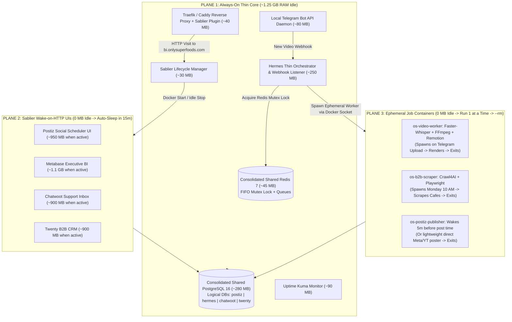

# HOSTINGER 8GB "SCALE-TO-ZERO" ARCHITECTURE & AI DIGITAL CO-FOUNDER BLUEPRINT
**Entity:** Only SuperFoods | **Target Server:** Hostinger KVM VPS (2 vCPU, 8 GB RAM, 100 GB NVMe SSD, No GPU)  
**Scope:** Event-Driven Wake-on-Demand Container Orchestration + Realistic AI Digital Co-Founder ("Social Media Face")  
**Status:** Architectural Research & Design Proposal (Pre-Implementation Review)

---

## TABLE OF CONTENTS
1. [Executive Hardware Reality Check (2 vCPU / 8 GB RAM)](#1-executive-hardware-reality-check-2-vcpu--8-gb-ram)
2. [The "Wake-on-Demand" Scale-to-Zero Architecture](#2-the-wake-on-demand-scale-to-zero-architecture)
   - 2.1 The Three Resource Planes (Always-On Thin Core, Sablier UI Wake, Ephemeral Workers)
   - 2.2 Database & Cache Consolidation (Saving 2.5 GB RAM Immediately)
   - 2.3 Preventing CPU Thrashing: Redis Mutex Single-Concurrency Lock
   - 2.4 Memory Budget Matrix (Idle vs. Peak Rendering)
   - 2.5 Reference Architectural Configuration (Sablier + Docker Profiles + Swap)
3. [Brief & Introduction: The "AI Digital Co-Founder" Concept](#3-brief--introduction-the-ai-digital-co-founder-concept)
   - 3.1 What Is an AI Digital Co-Founder and How Does It Work?
   - 3.2 Co-Founder Reality Check: Avoiding the "Uncanny Fake Founder" Trust Trap
   - 3.3 The Winning Formula: "3-Second AI Host Hook + Real Raw Farm Footage"
4. [Deep Comparison: AI Avatar Platforms & Open-Source Options](#4-deep-comparison-ai-avatar-platforms--open-source-options)
   - 4.1 Higgsfield AI (`Soul 2.0`, `Soul ID`, `Seedance`)
   - 4.2 Open-Source + Serverless GPU Stack (`Flux.1 LoRA` + `OmniHuman` / `LatentSync` via Fal.ai)
   - 4.3 HeyGen Developer API (`Avatar IV` / Digital Twin)
   - 4.4 Self-Hosted Open-Source (`MuseTalk` / `LivePortrait` on Rentable GPUs)
   - 4.5 Master Avatar Comparison Matrix
5. [The Character Consistency Playbook (Locking Face, Voice & Vibe Forever)](#5-the-character-consistency-playbook)
6. [End-to-End Hybrid Production Pipeline on the 8 GB Hostinger VPS](#6-end-to-end-hybrid-production-pipeline)
7. [Updated Monthly Operating Budget (Excluding Already-Owned VPS)](#7-updated-monthly-operating-budget)
8. [Summary Recommendations & Review Checklist](#8-summary-recommendations--review-checklist)

---

# 1. Executive Hardware Reality Check (2 vCPU / 8 GB RAM)

You have already provisioned a **Hostinger VPS with 2 vCPU cores, 8 GB RAM, and 100 GB NVMe storage** (CPU-only, no dedicated NVIDIA GPU). This is an ideal, cost-effective orchestration server—**provided we do not run all services simultaneously.**

### Why Naive "Always-On" Deployment Fails on 8 GB RAM
If we simply run `docker compose up -d` for every tool from our previous blueprint simultaneously:
- **Postiz Stack** (Next.js + NestJS + Temporal + Postgres + Redis): `~2.2 GB RAM`
- **Metabase BI** (Java JVM): `~1.3 GB RAM`
- **Chatwoot** (Ruby on Rails + Sidekiq): `~1.2 GB RAM`
- **Twenty CRM** (NestJS + React): `~1.2 GB RAM`
- **Remotion + Headless Chromium** (Video Render): `~2.0 GB RAM`
- **Faster-Whisper + Kokoro TTS** (Audio/Voice AI): `~1.5 GB RAM`
- **Crawl4AI + Playwright** (B2B Browser Scraper): `~1.5 GB RAM`
- **Hermes Agent + Local Telegram Bot API**: `~0.6 GB RAM`

**Total Naive RAM Demand:** `~11.5 GB+` $\rightarrow$ **Result: Immediate Linux OOM-Killer crashes and frozen CPUs.**

### Two Critical Architectural Mandates for This Server:
1. **Scale-to-Zero ("Wake-on-Demand"):** Heavy UIs and processing engines consume **0 MB RAM** while idle. They spin up only when triggered by an HTTP request, webhook, or scheduled cron, execute their work, and automatically shut back down.
2. **Serverless GPU Offloading:** Because a 2-vCPU Hostinger VPS has **no GPU**, local execution of heavy generative video/image AI models (Flux, OmniHuman, LatentSync) is physically impossible (it would take 45+ minutes per frame on CPU). Instead, the Hostinger VPS acts as the **lightweight conductor**, making fast REST API calls to serverless GPU providers (Fal.ai, Higgsfield, HeyGen, OpenRouter) for pennies per clip, then assembling the final MP4 locally via FFmpeg/Remotion.

---

# 2. The "Wake-on-Demand" Scale-to-Zero Architecture

To keep idle memory under **1.4 GB** while preserving access to every single enterprise capability, we partition your Hostinger VPS into **Three Resource Planes**:



---

## 2.1 The Three Resource Planes

### Plane 1: The Ultra-Thin Always-On Core (`~1.25 GB RAM total`)
Only services that *must* respond instantaneously to webhooks or route traffic remain alive 24/7:
- **Traefik + Sablier (`sablierapp/sablier`):** Routes domains (`bi.onlysuperfoods.com`, `social.onlysuperfoods.com`) and intercepts requests to sleeping apps.
- **Single Shared PostgreSQL + Single Shared Redis:** Holds all application state and job queues.
- **Local Telegram Bot API + Hermes Thin Daemon:** Waits silently for incoming farm videos on Telegram, incoming WhatsApp/ManyChat webhooks, or cron ticks. Consumes near-zero CPU when waiting.

### Plane 2: Sablier "Wake-on-HTTP" Dashboards (`0 MB Idle`)
When you open `bi.onlysuperfoods.com` (Metabase), `crm.onlysuperfoods.com` (Twenty CRM), or `social.onlysuperfoods.com` (Postiz):
1. Traefik intercepts your browser request.
2. **Sablier** automatically runs `docker start metabase`, displaying a sleek animated "Waking up your dashboard..." screen for 12–18 seconds.
3. Once healthy, your browser routes straight into Metabase.
4. **15 minutes after you close the browser tab**, Sablier automatically stops the container (`docker stop`), reclaiming all `~1.1 GB` of RAM back to zero!

### Plane 3: Ephemeral Task Workers (`0 MB Idle` $\rightarrow$ Run $\rightarrow$ Self-Destruct)
Heavy batch processes do **not** sit idle in Docker Compose:
- **Video Assembly Worker (`os-video-worker`):** Triggered only when Hermes detects a new raw farm clip on Telegram or generates an AI Digital Co-Founder clip. Spawns with `--rm`, runs Faster-Whisper + Remotion Chromium for ~60–90 seconds, uploads the rendered MP4, and **completely destroys itself**, dropping RAM usage back to `0 MB`.
- **B2B HoReCa Scraper (`os-b2b-scraper`):** Triggered via cron once a week (Monday 10:00 AM). Spins up Crawl4AI/Playwright for 10 minutes, extracts Bangalore restaurant leads into Supabase/Twenty, and exits.
- **Smart Scheduling Optimization for Postiz:** Postiz normally keeps Temporal + NestJS running 24/7 (`~1.5 GB RAM`) just to wait for post times. We solve this cleanly in one of two ways:
  - **Method A (Ultra-Lean Cron Wake):** Keep Postiz sleeping via Sablier (`0 MB idle`). When you schedule posts inside the Postiz UI, Hermes mirrors the `scheduled_at` timestamps into a tiny host cron / Redis delayed queue. **5 minutes before publish time** (e.g., 07:10 AM), Hermes wakes the Postiz + Temporal container; Postiz executes the official Meta/YouTube upload; 15 minutes later Sablier puts Postiz back to sleep!
  - **Method B (Direct Publishing Micro-Script):** Use Postiz strictly as your visual calendar & OAuth manager woken via Sablier, or let a tiny 40 MB Python/Node script execute the actual scheduled Instagram/YouTube API post directly using Postiz's stored OAuth tokens.

---

## 2.2 Database & Cache Consolidation (Saving 2.5 GB RAM)

Never deploy separate Postgres and Redis containers for every Docker Compose stack. On an 8 GB VPS, running 4 Postgres instances wastes ~1.2 GB of RAM before a single row is queried.
- Deploy **ONE PostgreSQL 16 container** tuned for lean memory (`shared_buffers=128MB`, `max_connections=100`), containing separate logical databases: `db_postiz`, `db_chatwoot`, `db_twenty`, and `db_hermes`. *(Even better: store Hermes/analytics tables on your existing Supabase cloud project to save additional VPS disk I/O).*
- Deploy **ONE Redis 7 container** (`maxmemory 256mb`) using isolated DB indexes (`0` for Postiz, `1` for Hermes/Mutex, `2` for Chatwoot).

---

## 2.3 Preventing CPU Thrashing: Redis Mutex Single-Concurrency Lock

With only **2 vCPU cores**, if a Telegram video render (Remotion) and a B2B web scrape (Playwright) execute at the exact same second, both processes will fight for CPU threads, causing extreme latency or crashes.
- **The Solution:** Every Plane 3 Ephemeral Worker **must acquire a single global Redis Mutex Lock (`lock:heavy_compute_slot`)** before booting.
- If the B2B scraper is currently running when you drop a harvest video on Telegram, Hermes politely queues the video job and spawns `os-video-worker` the exact second the scraper releases the lock and exits. **Only one heavy worker touches the 2 vCPUs at any given moment.**

---

## 2.4 Memory Budget Matrix (8 GB Physical + 4 GB ZRAM/NVMe Swap)

| System State | Running Services | Active RAM Usage | Remaining Free RAM | CPU Load |
| :--- | :--- | :---: | :---: | :---: |
| **90% of the Day (Idle / Listening)** | Plane 1 Thin Core only (Proxy, Sablier, Shared PG/Redis, Hermes Daemon, Local TG API, Uptime Kuma) | **~1.25 GB** | **6.75 GB Free** | `< 2%` |
| **Video Rendering Burst (90 seconds)** | Plane 1 Core + `os-video-worker` (Faster-Whisper + Remotion Chromium) | **~4.20 GB** | **3.80 GB Free** | `85–95%` (bounded) |
| **Founder Checking Dashboards** | Plane 1 Core + Metabase OR Postiz UI (via Sablier) | **~2.45 GB** | **5.55 GB Free** | `10–25%` |
| **Worst-Case Overlap (Dash + Render)** | Plane 1 Core + 1 Sablier UI + 1 Mutex-Locked Worker | **~5.40 GB** | **2.60 GB Free** | `90%` (Stable!) |

*Safety Cushion:* We also configure **4 GB NVMe Swap + ZRAM** (`vm.swappiness=10`) on the 100 GB NVMe disk so brief Chromium memory spikes never trigger an OOM kill.

---

## 2.5 Reference Architectural Configuration (Concept Blueprint)

Below is how Sablier and Ephemeral Docker profiles work cleanly in configuration (for architectural review):

```yaml
# Conceptual Docker Compose Topology (Scale-to-Zero Pattern)
services:
  # --- PLANE 1: ALWAYS-ON CORE ---
  sablier:
    image: sablierapp/sablier:latest
    command: ["start", "--provider.name=docker", "--strategy.dynamic.timeout=15m"]
    volumes:
      - /var/run/docker.sock:/var/run/docker.sock
    mem_limit: 64m

  shared-postgres:
    image: postgres:16-alpine
    command: postgres -c shared_buffers=128MB -c max_connections=100
    mem_limit: 384m

  shared-redis:
    image: redis:7-alpine
    command: redis-server --maxmemory 200mb --maxmemory-policy allkeys-lru
    mem_limit: 256m

  # --- PLANE 2: SABLIER WAKE-ON-HTTP UIs (0 MB IDLE) ---
  metabase:
    image: metabase/metabase:latest
    labels:
      - "sablier.enable=true"
      - "sablier.group=bi-ui"
      - "traefik.http.middlewares.bi-wake.plugin.sablier.group=bi-ui"
    deploy:
      replicas: 0 # Sleeps at 0 MB until visited in browser!
    mem_limit: 1536m

  postiz-ui:
    image: ghcr.io/gitroomhq/postiz-app:latest
    labels:
      - "sablier.enable=true"
      - "sablier.group=social-ui"
    deploy:
      replicas: 0 # Wakes on browser visit OR 5m before post publish!
    mem_limit: 1280m

  # --- PLANE 3: EPHEMERAL WORKER PROFILE (NEVER KEPT RUNNING) ---
  video-worker:
    image: onlysuperfoods/remotion-whisper-worker:latest
    profiles: ["ephemeral"] # Only invoked via `docker compose run --rm video-worker`
    cpus: 1.75
    mem_limit: 3584m
```

---

# 3. Brief & Introduction: The "AI Digital Co-Founder" Concept

## 3.1 What Is an AI Digital Co-Founder and How Does It Work?

Since you prefer staying behind the scenes while building Only SuperFoods, an **AI Digital Co-Founder ("Social Media Face")** is a custom, hyper-realistic synthetic brand persona—for example, **"Maya, Only SuperFoods' Chief Nutrition & Harvest Host"**—who acts as the recurring human face and voice across your Instagram Reels, YouTube Shorts, product tutorials, and promotional graphics.

Because AI models generate random strangers every time you type a prompt, creating a believable recurring person requires chaining **three specialized building blocks**:
1. **The Visual Identity Lock (Character Training / LoRA or Soul ID):** We feed 15–20 ultra-consistent reference images of one specific look (e.g., an approachable, warm, health-conscious young Indian woman in her mid-20s wearing natural earthy linen clothing) into an AI model trainer. This locks her exact facial geometry, smile, skin texture, and hair so she looks like the **exact same person** in every single post.
2. **The Consistent Voice Lock (Voice Cloning / TTS):** We lock a single voice ID (warm, conversational urban Bengaluru English accent) so viewers instantly recognize her voice the moment a Reel auto-plays.
3. **Motion & Lip-Sync Engine:** We animate a still photo of her inside a real kitchen or farm setting, driving natural head movements, eye blinks, subtle hand gestures, and frame-accurate lip-syncing to her voiceover script.

---

## 3.2 Co-Founder Reality Check: Avoiding the "Uncanny Fake Founder" Trust Trap

As your Chief Growth Officer, I must challenge one critical assumption before you deploy this:

> **The Danger of Deception:** Bengaluru’s Whitefield, Indiranagar, and Koramangala consumer base consists heavily of software engineers, tech founders, and AI-literate professionals. If you pretend your AI avatar is a real human named "Ananya" who picked mushrooms in Kadugodi at 5 AM, and viewers spot a tiny AI lip-sync glitch or unnatural finger movement, **comments like *"Fake AI account / scam"* will instantly erode brand trust.**

### How We Turn This into a Brilliant Competitive Advantage Instead:
1. **Transparent & Memorable Positioning ("Meet Maya, Our Digital Co-Founder"):**
   Own it playfully and proudly in your bio and pinned launch Reel:
   > *"Meet Maya — Only SuperFoods' AI Digital Co-Founder & Nutrition Host 🌱 While our shy human farming team stays inside the Kadugodi fruiting chambers harvesting your mushrooms at 5:00 AM, Maya brings you daily fresh drop alerts, 10-minute recipes, and gut-health science!"*
   - **Why this works:** Tech-savvy Whitefield audiences love futuristic transparency. You eliminate 100% of "fake scam" backlash while gaining all the benefits of a recognizable human-like face, warmth, and consistent storytelling!
2. **Never Let AI Fake Your Real Mushrooms:**
   Consumers buying fresh food want to see **real, unedited produce**, not plastic-looking AI mushrooms. Never ask an AI avatar generator to hallucinate a punnet of Grey Oyster mushrooms from scratch—it will distort your packaging logo or mushroom gills. Keep the AI avatar strictly for **face/voice/human presence**, and showcase your **real smartphone farm clips** for the product itself.

---

## 3.3 The Winning Formula: "3-Second AI Host Hook + Real Raw Farm Footage"

Trying to generate a 45-second continuous AI talking-head video is **expensive** ($2–$4 per video) and **boring** (viewer attention drops when someone stands still talking for 45 seconds).

Instead, our automated Hermes pipeline builds every Reel using the **5 + 20 Hybrid Cut Formula**:
- **Seconds 0:00 – 0:05 (The Magnetic Face Hook):** Maya appears in a warm kitchen or bright morning setting looking directly into the camera, smiling naturally, and speaking an energetic 5-second hook: *"Stop putting supermarket mushrooms in plastic bags—here’s why your Kadugodi harvest stays crisp for 7 days!"*
- **Seconds 0:05 – 0:25 (Real Authentic Farm B-Roll + Maya Voiceover):** Cut immediately to **your real raw smartphone video** from Telegram (hands packing breathable kraft punnets, mist spraying over Pink Oysters, sizzling garlic butter in a pan), overlaid with animated Remotion captions and Maya’s seamless voiceover continuing the story!
- **Seconds 0:25 – 0:30 (CTA Outro Card):** Branded closing card prompting viewers to comment `RECIPE` or `HARVEST` for ManyChat DM delivery.

**Why This Hybrid Formula Wins:**
- **75% Cheaper:** You only pay for **5 seconds** of expensive AI video lip-sync per Reel (`~$0.20 to $0.70`), while the remaining 20–25 seconds are free real footage rendered in Remotion!
- **Zero Uncanny Valley Fatigue:** Viewers see a pretty, engaging host for the crucial scroll-stopping hook, then immediately see **authentic, physical proof** of your clean Kadugodi farm.

---

# 4. Deep Comparison: AI Avatar Platforms & Open-Source Options

Because your Hostinger VPS has no GPU, all options below run cleanly via API calls triggered from Hermes on your VPS.

---

## 4.1 Higgsfield AI (`Soul 2.0`, `Soul ID`, `Seedance`)

- **Overview:** Built around **Soul 2.0** (ultra-realistic lifestyle photography/UGC generation), **Soul ID** (character identity persistence), and **Seedance** (fluid motion video synthesis).
- **Aesthetic Quality:** **Best-in-class "iPhone/Creator UGC" realism.** Unlike corporate avatar tools that make presenters look like news anchors against a white screen, Higgsfield characters look naturally lit, candid, and authentic—like a real food creator filming a selfie Reel in a sunlit Bangalore apartment.
- **How Character Consistency Works:** You establish a custom **Soul ID** for Maya once, then reference that ID across prompts and API calls (including CLI/MCP tooling).
- **Pricing Reality Check:**
  - *Web Creator Subscriptions:* ~$19 to $129+/month (includes generous monthly Soul 2.0 image/video allowances, great for creating a bank of 50 static photos and lifestyle B-roll poses manually).
  - *Developer API (Automated by Hermes):* Billed on a **separate pay-as-you-go credit balance** (no permanent free tier). Programmatic generation runs roughly **$0.05 to $0.15+ per base generation**, scaling up depending on resolution, clip length, and Seedance video complexity.
- **Limitation:** Web credits do **not** transfer to the Developer API. Additionally, while Higgsfield excels at cinematic lifestyle movements and short poses, dedicated talking-head lip-sync for fast spoken dialogue is often outperformed by HeyGen Avatar IV or OmniHuman.
- **Best Use for Only SuperFoods:** Generating Maya's high-fashion / lifestyle food-creator photography (e.g., Maya holding a glass of kombucha at a sunny breakfast table) and dynamic movement clips.

---

## 4.2 Open-Source + Serverless GPU Stack (`Flux.1 LoRA` + `OmniHuman` / `LatentSync` via Fal.ai)

This is the **sovereign developer route**: you use open-source AI model weights hosted on **fal.ai** (pay-per-second serverless GPU API, zero monthly subscription, no GPU server needed).

- **Step 1 — Train Your Permanent Character (`fal-ai/flux-lora-fast-training`):**
  - **Cost:** **~$2.00 one-time fee**.
  - **Output:** Produces a downloadable `.safetensors` LoRA model file encoding Maya’s exact face. You own this file forever—zero platform lock-in.
- **Step 2 — Generate Unlimited Lifestyle Photos (`fal-ai/flux-lora`):**
  - **Cost:** **~$0.025 to $0.03 per image**.
  - Generate crisp portraits of Maya for Instagram carousels, WhatsApp promotional banners, website testimonial sections, and video intro anchor frames.
- **Step 3 — Animate & Lip-Sync the 5-Second Hook Clip (Two Engine Choices):**
  - **Choice A: ByteDance OmniHuman v1.5 (`fal-ai/omnihuman`) — *Maximum Realism***
    - Takes 1 Flux portrait + 1 voice audio file. Generates natural breathing, hand gestures, facial micro-expressions, and expressive emotion.
    - **Cost:** **$0.14 per second** (A 5-second Reel hook = **$0.70 / ~₹59**).
  - **Choice B: ByteDance LatentSync (`fal-ai/latentsync`) — *Ultra Budget Lip-Sync***
    - Takes a pre-generated looping idle video clip (e.g., Maya smiling and nodding gently in her kitchen) and seamlessly re-syncs her lips to match new spoken audio!
    - **Cost:** **~$0.20 per video** (flat base fee per clip up to 40s!). That’s **~₹17 per talking Reel!**

---

## 4.3 HeyGen Developer API (`Avatar IV` / Custom Photo Avatar)

- **Overview:** The industry gold standard for plug-and-play AI talking avatars.
- **How It Works:** You upload one crisp Flux/Higgsfield portrait of Maya into HeyGen. When Hermes sends a text script + voice selection to the HeyGen REST API, HeyGen returns a finished, naturally gesturing, lip-synced MP4 video.
- **Pricing Reality Check:**
  - **Pay-As-You-Go API:** Starts with just a **$5 minimum prepaid top-up** (no mandatory monthly subscription required for API usage).
  - **Rates:** `Avatar III` costs **$0.0167/sec (~$1.00/min)**; `Avatar IV` (photorealistic single-photo expressive animation) costs **$0.05/sec (~$3.00/min)**. A 5-second hook costs **$0.25 (~₹21)**.
- **Pros:** Zero chaining complexity, exceptional audio-lip synchronization across Indian English accents, automatic natural hand gestures.
- **Cons:** Closed-source proprietary rendering; slightly stiffer "spokesperson" framing unless paired with varied background scenes.

---

## 4.4 Self-Hosted Open-Source (`MuseTalk` / `LivePortrait` on Rentable GPUs)

- **Models:** Tencent **MuseTalk** (MIT License, real-time lip-sync) and Kwai **LivePortrait** (MIT License, facial expression transfer).
- **Hardware Requirement:** Requires an NVIDIA GPU with 12GB–24GB VRAM (e.g., RTX 3090 / 4090). Cannot run on your CPU-only Hostinger VPS.
- **Rentable GPU Cloud (RunPod / Vast.ai):** Renting an on-demand RTX 4090 costs ~$0.34–$0.44/hour, plus container cold-boot time (~2–3 mins) and Python maintenance overhead.
- **Verdict:** At our volume (3 to 5 Reels per week), managing Docker GPU pods on RunPod creates unnecessary DevOps friction when **Fal.ai LatentSync** executes the exact open-source pipeline serverlessly for **$0.20 per clip** with zero idle billing.

---

## 4.5 Master Avatar Comparison Matrix

| Platform / Stack | Realism & UGC Vibe | Lip-Sync Precision | Character Ownership | API Automation | Cost for 5s Hook Clip | Cost for 30s Full Avatar Video | Best Role for Only SuperFoods |
| :--- | :---: | :---: | :---: | :---: | :---: | :---: | :--- |
| **Fal.ai Stack (`Flux LoRA` + `LatentSync`)** | High (9/10) | High (8.5/10) | **100% Owned (`.safetensors`)** | Seamless REST API | **~$0.20 (₹17)** | **~$0.20 (₹17)** | **Best Overall ROI & Sovereignty** (Looping base video + cheap lip-sync + infinite Flux photos) |
| **Fal.ai `OmniHuman v1.5`** | **Extreme (9.5/10)** | **Extreme (9.5/10)** | Uses Flux LoRA image | Seamless REST API | **~$0.70 (₹59)** | **~$4.20 (₹355)** | **Best for 5-Second Viral Scroll-Stop Hooks** (expressive upper-body movement) |
| **HeyGen API (`Avatar IV`)** | High (8.5/10) | **Extreme (9.5/10)** | Cloud-hosted inside HeyGen | Easiest REST API | **~$0.25 (₹21)** | **~$1.50 (₹126)** | **Easiest Zero-Code Setup** (Ideal for Phase 1 launch) |
| **Higgsfield (`Soul 2.0` + `Seedance`)** | **Extreme UGC (9.8/10)** | Moderate (7.5/10) | Custom `Soul ID` | Web App + Paid API | **~$0.15–$0.40** | **$1.00+** | **Best for Lifestyle Anchor Images & Cinematic B-Roll** |
| **Self-Hosted `MuseTalk` (RunPod GPU)** | Good (8/10) | Good (8/10) | 100% Open Source | Custom FastAPI wrapper | ~$0.05 (compute) | ~$0.15 (compute) | Overkill DevOps maintenance for 2–4 posts/week |

---

# 5. The Character Consistency Playbook

How do we make sure "Maya" looks like the exact same co-founder across 100 Instagram posts, WhatsApp recipe PDFs, and YouTube Shorts without drifting faces?

```
+-----------------------------------------------------------------------------------------+
|                   THE 5-PILLAR CHARACTER CONSISTENCY SYSTEM                            |
+-----------------------------------------------------------------------------------------+
|                                                                                         |
|   1. SEED ANCHOR GENERATION (Higgsfield Soul 2.0 or Flux Dev)                           |
|   Generate 20 pristine angles of one persona ("Maya": mid-20s Indian woman, warm smile, |
|   light linen apron, natural window lighting). Pick strictly consistent face geometry.  |
|                                           |                                             |
|                                           v                                             |
|   2. WEIGHTS TRAINING (Flux LoRA - $2.00 One-Time on Fal.ai)                            |
|   Train a dedicated LoRA model (`osf_maya_v1.safetensors`) with trigger token `osf_maya`|
|   Now ANY background or pose renders her exact nose, eyes, jawline, and hair.           |
|                                           |                                             |
|                                           v                                             |
|   3. BASE MOTION LOOPS ("Master Reaction Clips")                                        |
|   Generate 4 reusable 6-second silent video loops of Maya smiling, nodding, pointing,   |
|   or sipping kombucha in a sunlit kitchen (via Higgsfield Seedance / Kling).            |
|   Reuse these master loops infinitely with LatentSync ($0.20/clip) for fresh scripts!   |
|                                           |                                             |
|                                           v                                             |
|   4. VOICE CLONE LOCK (ElevenLabs Dedicated Voice ID)                                   |
|   Lock ONE specific warm, clear urban Indian English voice profile. Never change pitch  |
|   or accent between videos. Store ID inside Hermes `brand_persona.json`.               |
|                                           |                                             |
|                                           v                                             |
|   5. REAL PRODUCT PROTECTION RULE                                                       |
|   NEVER generate AI mushrooms or fake branded boxes in her hands—AI garbles text and    |
|   makes food look waxy. Overlay crisp real product PNGs in Remotion, or cut cleanly     |
|   to your authentic Telegram smartphone clips!                                          |
+-----------------------------------------------------------------------------------------+
```

---

# 6. End-to-End Hybrid Production Pipeline on the 8 GB Hostinger VPS

Here is exactly how your **8 GB Hostinger VPS** coordinates with **cloud AI APIs** when you upload a raw farm video, keeping VPS resource usage crisp and bounded:

```mermaid
sequenceDiagram
    autonumber
    actor Founder as Founder (Kadugodi Farm)
    participant TG as Telegram Channel + Local Bot API (Hostinger Core)
    participant Hermes as Hermes Agent Daemon (Hostinger Core)
    participant AI_Cloud as OpenRouter + ElevenLabs + Fal.ai (Serverless GPUs)
    participant Mutex as Redis Mutex Lock (Hostinger Core)
    participant Worker as Ephemeral Docker Worker (os-video-worker)
    participant Postiz as Postiz Scheduler (Woken on Demand)

    Founder->>TG: Drops 25s raw smartphone video of Pink Oyster harvest
    TG->>Hermes: Webhook fires; video saved to NVMe scratch disk
    Hermes->>AI_Cloud: Calls Gemini 2.0 Flash:free -> Analyzes raw footage
    Hermes->>Hermes: Writes 5s Maya Hook Script + 20s Voiceover Narration
    Hermes->>AI_Cloud: Calls ElevenLabs -> Synthesizes Maya's locked voice (.mp3)
    Hermes->>AI_Cloud: Calls Fal.ai (OmniHuman or LatentSync on Master Loop) -> Generates 5s Maya Intro Clip
    AI_Cloud-->>Hermes: Downloads 5s Maya Intro MP4 to Hostinger NVMe (~6 MB)

    Hermes->>Mutex: Acquire `lock:heavy_compute_slot`
    Hermes->>Worker: `docker compose run --rm video-worker` (Wakes from 0 MB!)
    Worker->>Worker: Faster-Whisper transcribes audio -> Remotion stitches [5s Maya Intro] + [20s Real Farm B-Roll] + [Karaoke Captions] + [Brand CTA]
    Worker-->>Hermes: Final 1080x1920 MP4 rendered (~75 seconds)
    Worker->>Worker: Container exits & self-destructs (RAM returns to 0 MB!)
    Hermes->>Mutex: Release lock

    Hermes->>Founder: Sends WhatsApp/Telegram preview: "Reel Ready! Approve for 07:15 AM?"
    Founder->>Hermes: Replies "Approve"
    Hermes->>Postiz: Schedules post via API (or wakes Postiz 5m before 07:15 AM publish)
```

### Key Architectural Wins of This Flow:
1. **Zero GPU Cost on VPS:** All heavy facial rendering happens in 20 seconds on Fal.ai / HeyGen serverless GPUs.
2. **Zero Idle Video Bloat:** Faster-Whisper and Remotion only occupy RAM during the 75-second render window, then vanish completely.
3. **Carousel & Static Posts:** For Tuesday/Thursday educational carousels, Hermes generates a fresh photo of Maya via `fal-ai/flux-lora` (**$0.03**), passes it into **Satori/Puppeteer** inside the ephemeral worker, overlays crisp nutrition facts and your logo, and destroys the container in 3 seconds!

---

# 7. Updated Monthly Operating Budget (Excluding Already-Owned VPS)

Since your **Hostinger 8 GB VPS is already paid for**, your incremental monthly operating spend for an entire AI marketing department + realistic digital co-founder is remarkably lean:

| Component | Recommended Tool / Tier | Usage Assumptions (Per Month) | Monthly Cost (USD) | Monthly Cost (INR) |
| :--- | :--- | :--- | :---: | :---: |
| **Hostinger VPS (2 vCPU, 8GB, 100GB)** | *Already Owned* | 24/7 Thin Core + Ephemeral Workers | *$0 (Sunk Cost)* | *₹0 Incremental* |
| **Text & Vision Brain** | OpenRouter (`:free` + Gemini Flash fallback) | ~5M tokens + 50 video analyses | **$0.00 – $2.00** | **₹0 – ₹170** |
| **Digital Co-Founder Training** | `fal-ai/flux-lora-fast-training` | 1x initial character training | **$2.00 (One-Time)** | **₹170 (One-Time)** |
| **Carousel & Story Photos (Maya)** | `fal-ai/flux-lora` | ~40 bespoke photos/month | **$1.20** | **₹100** |
| **AI Host Video Clips (5s Hooks)** | Option A: `LatentSync` on Master Loops<br/>Option B: `OmniHuman` / `HeyGen Avatar IV` | 12 Reels/month (3 per week) | **$2.40 (Option A)**<br/>**$3.00–$8.40 (Opt B)** | **₹200 (Opt A)**<br/>**₹250–₹700 (Opt B)** |
| **Dedicated Locked Voiceover** | ElevenLabs Starter Plan (or Kokoro Local) | ~30,000 characters/month (or ₹0 Kokoro) | **$5.00** *(or $0)* | **₹420** *(or ₹0)* |
| **Instagram Comment-to-DM** | ManyChat Free Tier $\rightarrow$ Pro Tier | Free up to 1,000 contacts; $15/mo Pro | **$0.00 $\rightarrow$ $15.00** | **₹0 $\rightarrow$ ₹1,260** |
| **Social Publishing, Analytics & CRM**| Postiz + Sablier + Metabase + Twenty + Dub | Self-hosted scale-to-zero on VPS | **$0.00** | **₹0** |
| **TOTAL MONTHLY RUNNING COST** | **Lean MVP Mode (Start)**<br/>**Full Growth Mode (ManyChat Pro + ElevenLabs)** | | **$3.60 – $10.00 / mo**<br/>**$23.60 – $29.00 / mo** | **₹300 – ₹850 / mo**<br/>**₹1,980 – ₹2,450 / mo** |

---

# 8. Summary Recommendations & Review Checklist

1. **Infrastructure Strategy on Your 8 GB VPS:**
   - Consolidate into **one PostgreSQL 16** and **one Redis 7** container.
   - Install **Sablier** with Traefik/Caddy so Metabase, Postiz UI, Chatwoot, and Twenty CRM sleep at **0 MB RAM** until you open their URLs.
   - Package Remotion, Faster-Whisper, and Crawl4AI as **ephemeral `--rm` Docker containers** protected by a Redis single-concurrency lock so your 2 vCPUs never choke.
   - Configure **4 GB NVMe Swap + ZRAM** as an emergency cushion.

2. **AI Digital Co-Founder Execution Path (Recommended Hybrid):**
   - **Step 1 (Character Creation):** Generate 20 high-craft lifestyle portraits of **"Maya"** using **Higgsfield (`Soul 2.0`)** or **Flux Dev** (one-time creative session to nail her authentic urban Indian look).
   - **Step 2 (Character Lock):** Train a custom **Flux LoRA (`$2.00`)** on Fal.ai so Hermes can generate unlimited matching photos of Maya at `$0.03` each, and generate 4 reusable silent kitchen/farm motion loops.
   - **Step 3 (Production Automation):** Use the **5-Second AI Hook + 20-Second Real Raw Farm Video** hybrid formula via **LatentSync (`$0.20/reel`)** or **HeyGen Avatar IV (`$0.25/hook`)** stitched seamlessly in Remotion.
   - **Step 4 (Honest Brand Framing):** Introduce Maya openly as Only SuperFoods' AI Digital Co-Founder & Farm Host so your Whitefield tech-savvy audience respects the innovation rather than suspecting deception.

---
*Ready for your review. Upon your sign-off on these architectural choices, we can proceed to configuring the Hostinger Docker Compose + Sablier stack and creating Maya's character bible.*

